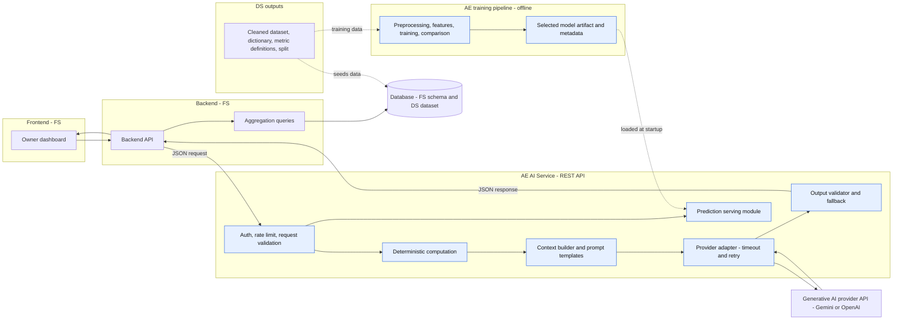
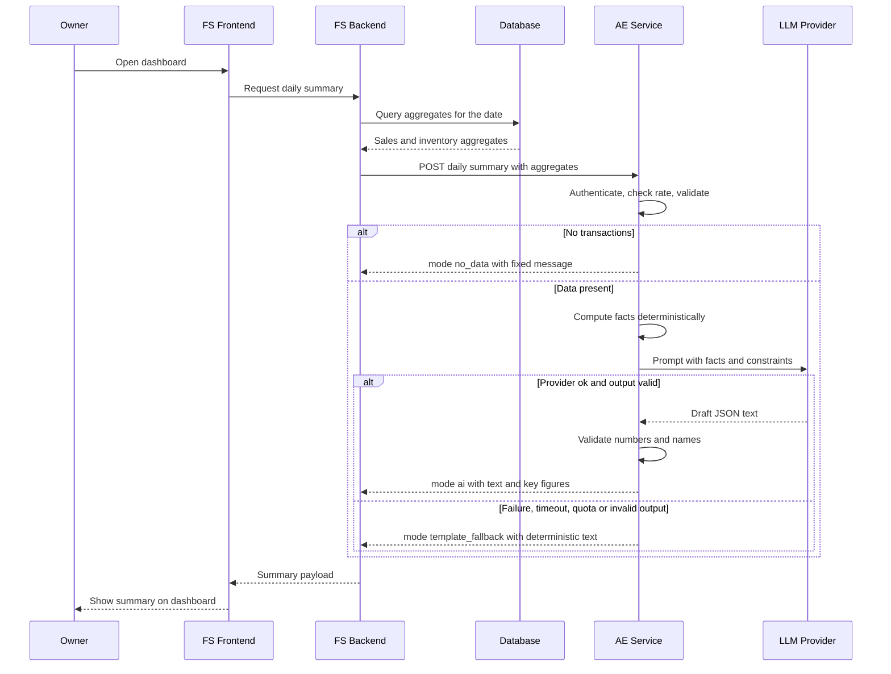
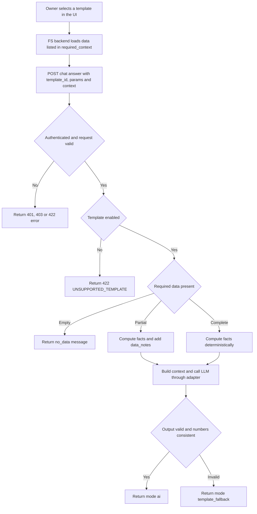
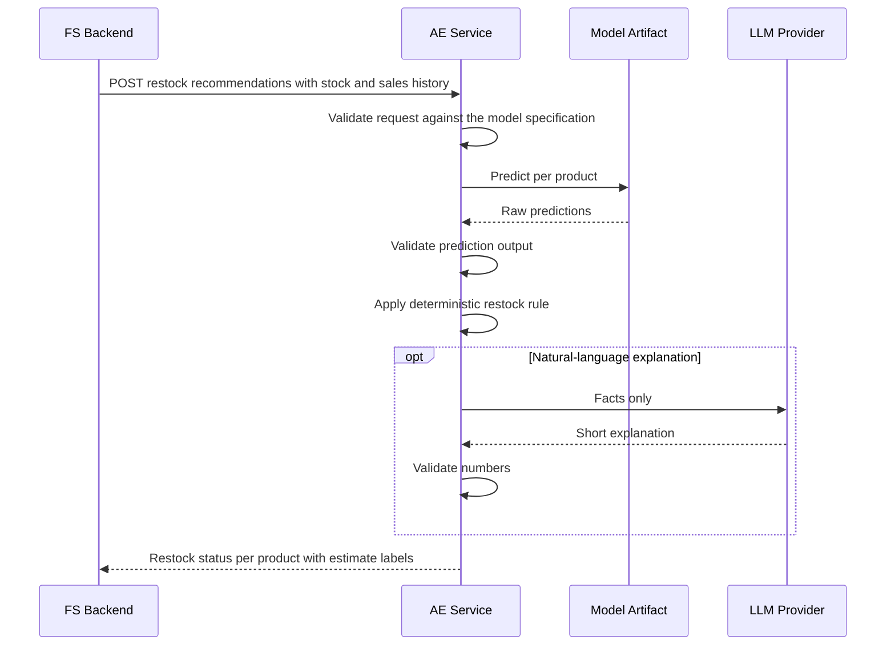

# PRD: AE (Next-Gen AI Engineer) Division — AI Service Layer

AI service layer for *Digitalisasi Sistem Kasir Terpadu dan Dasbor Pemantauan Stok Pintar Berbasis AI* · Team A26-CS169 · HC STORE IMPORT · **v0.2 · 9 November 2026**

> Repository copy of the team PRD. v0.1 (8 Nov 2026, PDF, 76 pages) is kept outside the repository because it contains personal data.
> Labels: **[CONFIRMED]** stated in the Project Plan or the Tech Stack Checklist · **[PROPOSAL]** AE recommendation that needs agreement from the named division · **[ASSUMPTION]** working assumption to be validated · **[TBD]** unresolved decision (collected in §26).

## 0. Changes from v0.1

| # | Change | Reason (source) |
|---|---|---|
| C1 | AE owns the sales prediction model end to end: preprocessing, features, training, comparison of at least two models, selection, export and serving. DS supplies the dataset, data dictionary, metric definitions and split definition. Replaces the v0.1 discrepancy (§4.5) and resolves OQ-01. New: AE-FR-034 to 038, F4, §16 rewritten, workflow F, tests MDL-01 to 05. | Project Plan feature table lists "Model prediksi penjualan per produk ... dibandingkan minimal 2 model" under the AE members; Plan Week 2 deliverable: "Model prediksi terpilih (format .pkl) dan endpoint REST API AI sukses dijalankan secara lokal". Checklist Gen AI Main Quest: "Membangun model AI yang disesuaikan dengan keadaan data yang disediakan oleh tim Data Science", "Menerapkan tahapan preprocessing data", "Membandingkan minimal 2 model atau konfigurasi dengan metrik yang sama". For DS, model development is a Side Quest; the DS Side Quest "Penyediaan Data untuk Model AI" covers data for the Gen AI team. Decided by the AE member on 9 Nov 2026; team and mentor confirmation pending. |
| C2 | The Main Quest comparison is met by the prediction model comparison (AE-FR-036). Generative configuration comparison AE-FR-082: Must → Should. | Follows from C1; saves free-tier quota. |
| C3 | Guided chat (F2: AE-FR-010 to 014, E4, E5): Must → Should. | Not in the Project Plan feature table, and the Plan states "Tidak ada perubahan" from the use case; needs a picker UI that FS has not planned; AE workload grows with C1. Reopen if the team adds it to the Plan (OQ-02). |
| C4 | Project window aligned with the Project Plan: Week 4 is 11–20 Dec 2026 (v0.1: 11–17 Dec). Capstone milestones added to §25. | Project Plan §C; Kick-Off timeline. |
| C5 | Personal identifiers (names, participant IDs) removed; roles only. | The repository may become public. |
| C6 | The prediction artifact is produced in this repository with the same pinned environment as the service, so the v0.1 risk of mismatched library versions between DS training and AE serving no longer applies. Colab stays optional for exploration. | Follows from C1. |
| C7 | OQ-01 resolved; OQ-10 to 13 move to AE; new OQ-30 to 33. | §26. |

## 1. Document Information

| Field | Value |
|---|---|
| Title | PRD — AE Division (AI Service Layer) |
| Project | Digitalisasi Sistem Kasir Terpadu dan Dasbor Pemantauan Stok Pintar Berbasis AI (Asah 2026 Capstone) |
| Team ID | A26-CS169 |
| Business partner | HC STORE IMPORT (shoes and sandals retail) |
| Version | 0.2 (9 Nov 2026). 0.1: 8 Nov 2026, first complete draft |
| Status | Draft, pending review by AE members, FS and DS counterparts, and the technical mentor |
| Responsible division | AE (two members) |
| Project window | 20 Nov – 20 Dec 2026, four weeks [CONFIRMED] |
| Intended audience | AE engineers (implementation reference); FS and DS (integration reference); technical mentor and assessors (review); capstone documentation |
| Source documents | Asah 2026 Project Plan (A26-CS169); Checklist Tech Stack (Main Quest and Side Quest); Capstone Kick-Off and Briefing #1; UMKM interview and use case; AE master prompt (basis of v0.1) |

This PRD covers only the AE scope. FS and DS work is described only where AE depends on it or must integrate with it.

## 2. Product Overview

### 2.1 Product description
The AE product is the AI service layer of the HC Store Import platform. It is a stateless, JSON-based REST service that:
1. turns structured sales and inventory data, supplied by the FS backend, into plain-language daily and weekly summaries and business observations for the store owner;
2. serves the per-product sales prediction model that AE trains offline from the DS dataset, and turns predictions plus current stock into restock information;
3. (Should) answers a fixed catalog of guided questions (sales and inventory) using only the data supplied with each request.

The AE service is called only by the FS backend, never directly by the browser. The Checklist lists this as a Side Quest (Gen AI accessed through the backend); this PRD adopts it as a design rule [PROPOSAL] because it keeps provider API keys off the client and lets the backend control which data the AI sees.

### 2.2 Project background
HC Store Import records transactions, stock updates and daily sales recaps by hand in notebooks [CONFIRMED]. The capstone builds a web-based POS, automatic stock deduction, an analytics dashboard and a Generative AI assistant. Two user groups exist: cashier/store staff (POS) and the owner (dashboard and AI assistant) [CONFIRMED]. The main flow: the cashier checks out a sale, stock decreases automatically, the transaction appears on the dashboard, and the owner reads charts plus an AI-written summary [CONFIRMED]. All sales history used for analytics, AI and model training is dummy/synthetic data, because the store's real records are fully manual [CONFIRMED].

### 2.3 Business problem (AE-relevant)
The owner has no quick way to understand store performance; charts and tables take time and some analytical skill. Restocking decisions are made without data on which products sell and which run low. An AI feature that invents numbers is worse than none; the Project Plan lists hallucinated figures as a project risk. The generative AI provider is a free-tier proprietary API with quota limits, and hosting is a free tier that can sleep when idle [CONFIRMED]. The AI layer must therefore degrade gracefully instead of breaking the dashboard.

### 2.4 Product vision
AE delivers an AI service layer that gives the owner reliable, understandable, data-grounded business insights and restock estimates. Reliability comes first: the system prefers a correct plain template over an impressive but unverifiable sentence.

### 2.5 Product objectives

| ID | Objective | How it is judged (numeric targets TBD where not specified) |
|---|---|---|
| O1 | The owner understands daily and weekly performance without reading raw tables | Summary produced for any day/week that has data; PIC UMKM feedback in Week 4 |
| O2 | Every number in AI output is traceable to supplied data | All numeric-consistency tests (§19, NUM-*) pass; no invented figures in hallucination tests |
| O3 | Guided chat answers only approved questions, from supplied data (Should) | Out-of-scope and unknown-template tests (§19) pass |
| O4 | The dashboard never shows a raw error because of the AI layer | Every failure mode in §18 returns a defined response and fallback |
| O5 | A prediction model trained on DS data, compared against a baseline, is available to the backend through an agreed contract | Comparison table of at least two models on the same holdout and metrics; prediction endpoint returns valid output; restock information shown to the owner |
| O6 | AE satisfies the Gen AI Main Quest checklist | README contains problem statement, data sources, preprocessing, comparison table of at least two models on the same metrics, and the selection reason |

## 3. Scope and Boundaries

### 3.1 AE scope of work
1. Develop REST APIs for AI model serving (FastAPI or Flask [CONFIRMED]; FastAPI proposed).
2. Integrate the AI service with the FS backend through an agreed API contract.
3. Design, implement and test prompts for generative AI (templates, constraints, output formats).
4. Build the AI assistant that generates daily and weekly sales summaries.
5. Train, compare and export the per-product sales prediction model from the DS dataset (preprocessing, features, at least two models, selection).
6. Serve the selected prediction model and derive restock information.
7. Process structured business data into the context used for AI responses.
8. Ground AI insights in the supplied data (deterministic computation, validation, fallback).
9. Implement error handling, timeout handling, rate limiting and fallback mechanisms.
10. (Should) Support guided chat using predefined question templates.
11. Deploy the AI API to a cloud free tier and document it (API docs, README sections, comparison tables).

### 3.2 In-scope features (MVP)

| Feature | Summary | Priority |
|---|---|---|
| F1. Automatic generative AI insights | Daily summary, weekly summary, sales performance insights, relevant observations | Must |
| F2. Guided AI chat assistant | Owner picks a predefined question (Sales or Inventory); AI answers from supplied data only | Should (C3) |
| F3. AI REST API | JSON endpoints for summaries, guided chat, predictions, health, with validation and error handling | Must |
| F4. Sales prediction model and restock information | Per-product prediction trained by AE on DS data, at least two models compared, selected model served; restock status from a deterministic rule | Must (restock status: Should) |
| Cross-cutting | Grounding, validation, fallback, rate limiting, logging, deployment, documentation | Must |

### 3.3 Out of scope

| Item | Reason |
|---|---|
| Free-text chat with arbitrary questions | Guided templates only (higher control, lower hallucination risk) |
| Profit, margin, supplier cost or tax analysis | Excluded in the Project Plan (supplier cost and net margin) [CONFIRMED] |
| Customer-level analytics or any customer identity data | Plan restricts data to non-identifying data [CONFIRMED] |
| POS UI, dashboard UI, general backend, database, stock deduction logic | FS responsibility |
| Dashboard charts and data analysis | DS responsibility |
| Payment gateway, WhatsApp/receipt integration, native mobile app, e-commerce, payroll | Excluded in the Project Plan [CONFIRMED] |
| AI taking actions (changing stock, prices, placing orders) | AI is read-only and advisory |
| Persisting AI history in the AE service | AE is stateless; FS may store results (FS Side Quest) |
| RAG with a vector database, intent classification model, sentiment model, Telegram/WhatsApp channel, locally hosted SLM | Side Quest items; not needed for the MVP. Revisit after the Must items are done |

### 3.4 MVP boundaries

| Capability | In MVP | Deferred |
|---|---|---|
| Summaries | Daily and weekly, one active provider, Indonesian text | Monthly or custom range, multi-language |
| Chat (Should) | Guided templates only (catalog in §14) | Free text, conversation memory, follow-up questions |
| Prediction | Train and compare at least two models (one a naive baseline), export the selected pipeline, serve per-product predictions, basic restock status | Auto-retraining, drift monitoring, what-if simulation |
| Grounding | Deterministic facts, schema and numeric validation, template fallback | LLM-as-judge validation, RAG |
| Operations | Health check, request IDs, basic logs, in-process rate limit | Alerting dashboards, distributed rate limiting |

### 3.5 Assumptions and constraints

| ID | Statement | Type |
|---|---|---|
| C1 | Four-week MVP; all main features connected by the end of Week 3 (10 Dec 2026) | Constraint [CONFIRMED] |
| C2 | Generative AI uses a proprietary API (Gemini or OpenAI) on a free tier with quota | Constraint [CONFIRMED] |
| C3 | Hosting uses a free tier (Render, Railway or Koyeb named as examples); the server may sleep when idle | Constraint [CONFIRMED] |
| C4 | All data is dummy/synthetic, so AI insights and model metrics demonstrate the pipeline, not real store accuracy | Constraint [CONFIRMED] |
| C5 | Two AE engineers share all AE work | Constraint [CONFIRMED] |
| A1 | FS sends already-aggregated data (and, for predictions, recent daily history) in each request; the AE service has no database access | Assumption / [PROPOSAL] |
| A2 | Owner-facing text is Indonesian, simple, non-technical | Assumption |
| A3 | Currency is IDR, whole numbers; quantities are pairs or units (integers) | Assumption |
| A4 | One store, one owner account in the MVP | Assumption |
| A5 | Business day boundary and timezone follow the store's local time (candidate: Asia/Makassar, UTC+8) | Assumption [TBD] |

## 4. Stakeholders and Responsibilities

### 4.1 Responsibility matrix

| Capability | AE | FS | DS |
|---|---|---|---|
| Cashier POS, cart, checkout, automatic stock deduction, product CRUD, stock-in | - | Owner | - |
| Database schema (ERD) and persistence | Reviews fields it consumes | Owner | Consulted |
| Synthetic dataset, cleaning, data dictionary | Consumer | Consumer | Owner |
| Metric definitions (revenue, units, transaction count, period comparison) | Consulted | Implements queries | Owner of definitions [PROPOSAL] |
| Dashboard charts and analytics | - | Integrates | Owner |
| Train/test split definition for the prediction model (time-based, no leakage) | Implements in the training script; reviews | - | Owner (DS Side Quest "Penyediaan Data untuk Model AI") [PROPOSAL] |
| Prediction model: preprocessing, features, training, comparison of at least two models, selection, export | Owner | - | Supplies data; cross-checks figures |
| Prediction serving endpoint (load artifact, validate, serve) | Owner | Calls it | - |
| Prompt design, LLM integration, response validation, fallback | Owner | Consulted | Consulted on metric wording |
| AI REST API implementation and deployment | Owner | Consumer | - |
| API contract (endpoints, JSON, error codes) | Co-owner | Co-owner | Consulted on data fields |
| Rendering AI output and error states in the frontend | - | Owner | - |
| Storing AI results/history in the database | - | Owner (if adopted) | - |
| Bug log (Notion, Google Sheets as second option) | Logs AI bugs | Logs FS bugs | Logs DS bugs |
| README sections | AI sections: problem, preprocessing, model comparison, generative design, out-of-scope tests, API usage | Setup and usage | Data sections: dataset, dictionary, analysis |

### 4.2 AE responsibilities in detail
AE owns everything between a validated backend request and a validated AI response: request validation, deterministic fact computation, prompt and context construction, provider calls (timeout, retry, throttling), output validation, fallback text, prediction serving, API documentation, deployment, monitoring and AE test cases. Offline, AE owns the prediction model pipeline from the DS dataset to the exported artifact.

### 4.3 What AE needs from FS
- Aggregated sales and inventory data in the agreed JSON shape for each request, plus the recent daily history per product that the prediction model needs.
- Stable product identifiers and consistent period boundaries (day and week).
- Handling of every AE response state in the UI: `ai`, `template_fallback`, `no_data`, and errors.
- Secure storage and injection of the AE service credential on the backend.

### 4.4 What AE needs from DS
- The synthetic training dataset: daily sales per product with enough history (length [TBD], OQ-30), clearly labeled as synthetic, with the generation method documented.
- The data dictionary: field meanings, units and value ranges.
- Metric definitions, so AI figures match dashboard figures.
- The split definition (time cutoff for the holdout), and a cross-check of the figures AE reports.

### 4.5 Ownership decision (replaces the v0.1 discrepancy)
v0.1 followed the AE master prompt (DS trains, AE serves) and flagged the conflict with the Project Plan. v0.2 follows the Project Plan and the Checklist: AE trains, compares, exports and serves the prediction model; DS provides the data. Reopen if the team or the mentor decides otherwise; then AE-FR-034 to 038 move to DS and AE keeps AE-FR-030 to 033.

## 5. User Personas

### 5.1 Primary persona: Store Owner of HC Store Import

| Attribute | Description |
|---|---|
| Role | Owns and manages a small shoes and sandals import retail store |
| Technical level | Non-technical; used to notebooks, not analytics tools |
| Context of use | Opens the dashboard between other tasks, on desktop or phone (the Checklist requires mobile browser access) |
| Goals | Know how today and this week went; see which products sell or decline; know what to restock and when |
| Needs | Short plain-language text; numbers that match the dashboard; a clear statement when data is missing; no jargon |
| Pain points | Manual recaps take time; trends are hard to read; stock surprises; low trust in tools that give wrong figures |
| Trust requirements | One wrong number can destroy trust; the AI must say it does not know instead of guessing |

### 5.2 Secondary personas
- **Cashier / store staff:** does not use the AI assistant in the MVP [ASSUMPTION]; affects AI quality indirectly, because transaction data accuracy comes from the POS.
- **FS backend developer (technical consumer):** needs a predictable contract, clear errors and API docs.
- **DS member (data provider):** needs a clear data contract for the training dataset.

## 6. User Stories

| ID | Story | Related requirements |
|---|---|---|
| US-01 | As a store owner, I want an automatically generated summary of today's sales, so that I understand store performance without reading raw tables. | AE-FR-001 |
| US-02 | As a store owner, I want an automatically generated weekly summary, so that I can see the week's performance and how it compares with the previous week. | AE-FR-002 |
| US-03 | As a store owner, I want to choose a sales question from a list (for example, which products sell the most), so that I get a quick answer without typing or filtering charts. | AE-FR-010 to 012 |
| US-04 | As a store owner, I want to choose an inventory question from a list (for example, which products have low stock), so that I know what needs attention. | AE-FR-010, AE-FR-013 |
| US-05 | As a store owner, I want a few clear observations based on the numbers (for example, a product whose sales dropped), so that I notice problems early. | AE-FR-003 |
| US-06 | As a store owner, I want to see which products are predicted to sell and may need restocking, together with current stock, so that I can restock before running out. | AE-FR-030 to 032 |
| US-07 | As a store owner, I want the AI to tell me when it cannot answer because data is missing, so that I never act on invented figures. | AE-FR-024, AE-FR-060 |
| US-08 | As a store owner, I want the numbers in AI text to match the dashboard, so that I can trust both. | AE-FR-021, AE-FR-023 |
| US-09 | As a store owner, I want to still see a basic summary if the AI service is busy or down, so that the dashboard is never empty or broken. | AE-FR-070 to 072 |
| US-10 | As an FS developer, I want a documented JSON contract with interactive API docs, so that I can integrate without guessing. | AE-FR-040, AE-FR-042 |
| US-11 | As an FS developer, I want consistent error codes and a clear response mode flag, so that the frontend can render a state for every outcome. | AE-FR-050, AE-FR-073 |
| US-12 | As a DS member, I want a clear data contract for the training dataset, so that the data I prepare can be used by the AE model without rework. | AE-FR-034 |
| US-13 | As an AE maintainer, I want request IDs and metadata in logs without sensitive payloads, so that I can debug safely. | §8, §17 |
| US-14 | As a mentor or assessor, I want a documented comparison of at least two prediction models on the same holdout and metrics, so that the Gen AI Main Quest is demonstrably met. | AE-FR-036 |
| US-15 | As an AE member, I want the training pipeline to be reproducible from one command, so that the served model can be rebuilt and checked. | AE-FR-038 |

## 7. Functional Requirements
Priority scale: **Must** (MVP cannot be accepted without it), **Should** (planned for the MVP, can slip if time is short), **Could** (only if time remains). Numeric targets the Project Plan does not specify are TBD.

### 7.1 Automatic summaries

| ID | Requirement | Description | Priority | Input | Expected output | Acceptance criteria |
|---|---|---|---|---|---|---|
| AE-FR-001 | Daily sales summary | Generate a plain-language summary of one business day from supplied metrics | Must | Date, sales aggregates (revenue, transaction count, units, top products), optional previous-day figures | JSON with `summary_text`, `key_figures`, `observations`, `generation_mode` | Every number in the text appears in `key_figures` and equals the supplied or derived value; text is Indonesian and non-technical; no claim without data |
| AE-FR-002 | Weekly sales summary | Same for a one-week range, with comparison to the previous week when supplied | Must | Week start/end, aggregates, optional daily breakdown, optional previous-week aggregates | Same shape as AE-FR-001 | Comparison wording appears only when previous-period data was supplied; totals equal the sum of supplied rows |
| AE-FR-003 | Business observations | Select observations by deterministic rules (for example top product, largest decline, number of low-stock products) and let the LLM phrase them | Should | Same as AE-FR-001/002 plus optional inventory snapshot | `observations[]`, each with an evidence reference to a supplied field | No observation without evidence; no cause or forecast claimed; maximum number of observations TBD |

### 7.2 Guided chat (feature priority: Should, C3)

| ID | Requirement | Description | Priority within F2 | Input | Expected output | Acceptance criteria |
|---|---|---|---|---|---|---|
| AE-FR-010 | Template catalog | Expose enabled question templates and the data each one requires | Must | GET request | List of `template_id`, category, display name, question text, `required_context` | Catalog equals §14 for enabled templates; disabled templates are not listed |
| AE-FR-011 | Guided question answering | Accept a template ID, parameters and context data; return an answer | Must | `template_id`, `params`, `context` | `answer_text`, `key_figures`, `generation_mode` | A valid request returns an answer built only from supplied data |
| AE-FR-012 | Sales information templates | Implement the sales templates in §14.1 | Must: SALES_TOP_PRODUCTS, SALES_PERIOD_PERFORMANCE, SALES_TRANSACTION_COUNT; Should: SALES_DECLINING_PRODUCTS | Template ID and sales context | Answer per the template's answer format | Answers match deterministic results in tests SAL-* |
| AE-FR-013 | Inventory information templates | Implement the inventory templates in §14.2 | Must: INV_LOW_STOCK, INV_STOCK_LEVEL; Should: INV_RESTOCK_NEEDED; Could: INV_HIGHEST_STOCK | Template ID and inventory context | Answer per the template's answer format | Answers match deterministic results in tests INV-* |
| AE-FR-014 | Reject non-template input | Unknown, disabled or missing template IDs and any free-text question field are rejected before any LLM call | Must | Any invalid chat request | HTTP 422 with `UNSUPPORTED_TEMPLATE` or `VALIDATION_ERROR` | At least 10 out-of-scope attempts are rejected or safely declined and recorded in the README (Side Quest) |

### 7.3 Data grounding

| ID | Requirement | Description | Priority | Input | Expected output | Acceptance criteria |
|---|---|---|---|---|---|---|
| AE-FR-020 | Request validation | Validate schema, types, ranges, dates, duplicate product IDs and payload size | Must | Any request | Validated object or `VALIDATION_ERROR` with field-level details | Invalid payloads never reach the LLM; every rule in §11 has a test |
| AE-FR-021 | Deterministic computation | Totals, rankings, percentage change and low-stock classification are computed in code from supplied rows; the LLM never calculates | Must | Validated data | Set of computed facts | Computed facts equal an independent calculation in unit tests |
| AE-FR-022 | Structured context builder | Build a compact, labeled facts list for the prompt; drop fields the task does not need | Must | Computed facts | Prompt context | Context contains only whitelisted fields; product names are passed as quoted data |
| AE-FR-023 | Output validation | Check JSON schema, numeric consistency, allowed product names and forbidden content before returning | Must | LLM output and allowed facts | Validated response or fallback | A response containing a number or product name not in the facts is never returned in `ai` mode |
| AE-FR-024 | Unavailable-data statement | When a required datum is missing, the answer says it is unavailable instead of estimating | Must | Context with gaps | Answer containing an explicit unavailability message | Hallucination tests HAL-* pass |

### 7.4 Prediction model and serving

| ID | Requirement | Description | Priority | Input | Expected output | Acceptance criteria |
|---|---|---|---|---|---|---|
| AE-FR-030 | Prediction serving endpoint | Load the selected artifact once at startup and serve per-product predictions | Must | Product IDs, horizon, recent daily history (§12.7) | Predicted units per product with model version | Valid input returns output equal to the training pipeline's offline prediction for the same input (PRD-01) |
| AE-FR-031 | Prediction input/output validation | Validate input against the model specification; validate output | Must | Prediction request and raw model output | Validated prediction or `PREDICTION_FAILED` | Non-finite, negative or mismatched values are rejected |
| AE-FR-032 | Restock information | Combine predictions and current stock through a deterministic rule to flag products that may need restocking; optional LLM wording | Should | Predictions, current stock, rule parameters [TBD] | Restock status per product plus a short explanation | Flags equal the rule's result; the explanation contains only supplied figures |
| AE-FR-033 | Prediction mention in narratives | Mention predictions in summaries or chat only as labeled estimates | Could | Validated predictions | Text that marks values as estimates | Estimate label present in every such sentence |
| AE-FR-034 | Training data contract | Load the DS dataset, validate it (schema, ranges, duplicates, date coverage) and record its source and hash | Must | DS dataset and data dictionary | Validated training table and a data report | Invalid or unlabeled data stops training with a clear message; the README names the source and that it is synthetic |
| AE-FR-035 | Preprocessing and features | Aggregate to product-day, fill missing days, build features from past data only; preprocessing is part of the exported pipeline | Must | Validated training table | Feature matrix and target | Leakage test MDL-01 passes; serving uses the same transformations as training |
| AE-FR-036 | Model comparison | Train at least two models, one a naive baseline, on the same time-based split; evaluate on the same holdout with the same metrics; select by a written rule | Must | Features, split definition | Comparison table (MAE, RMSE, WAPE, bias) and the selection reason | Table and reason in the README; metrics recomputed from saved holdout predictions match the table (MDL-02); selection follows the rule (MDL-05) |
| AE-FR-037 | Performance improvement | Hyperparameter tuning with time-series cross-validation on the training period only; report the effect | Should | Training period | Tuned parameters, before/after metrics | Before/after table in the README (Side Quest) |
| AE-FR-038 | Export and reproducibility | Export the selected pipeline with metadata and checksum; retrain from one command with a fixed seed | Must | Selected model | Artifact in `models/`, metadata JSON, SHA-256 | Loader verifies the checksum; retraining reproduces the holdout predictions (MDL-03, MDL-04) |

### 7.5 REST API serving

| ID | Requirement | Description | Priority | Input | Expected output | Acceptance criteria |
|---|---|---|---|---|---|---|
| AE-FR-040 | Versioned JSON REST API | All endpoints use JSON, an `/api/v1` prefix and correct HTTP status codes | Must | HTTP requests | JSON responses | Endpoint behavior matches §11 once agreed with FS |
| AE-FR-041 | Health check | Report service status, model-loaded flag and provider configuration status without calling the provider | Must | `GET /api/v1/health` | Status JSON | Returns within the hosting platform's health-check limits |
| AE-FR-042 | Interactive API docs | Publish OpenAPI/Swagger documentation | Should | - | Docs page | FS can call every endpoint from the docs page (Checklist Side Quest) |
| AE-FR-043 | Service authentication | Require a service credential on every endpoint except health | Must | Credential header | 401/403 on failure | Requests without a valid credential are rejected |
| AE-FR-044 | Rate limiting | Limit inbound request rate per credential and throttle outbound provider calls to the free-tier quota | Must | Request bursts | HTTP 429 with `Retry-After`, or a queued call | Burst test (§19) shows no provider quota error caused by AE's own bursts; limit values TBD |

### 7.6 Response formatting, empty data and errors

| ID | Requirement | Description | Priority | Input | Expected output | Acceptance criteria |
|---|---|---|---|---|---|---|
| AE-FR-050 | Standard response envelope | Every response carries `request_id`, a mode flag (`ai`, `template_fallback`, `no_data`) and metadata | Must | - | Uniform JSON | FS can render every state from the envelope alone |
| AE-FR-051 | Language and tone | Short Indonesian sentences, no jargon, IDR formatted with thousand separators, dates in plain format | Must | - | Owner-readable text | PIC UMKM review in Week 4 finds the text understandable (qualitative) |
| AE-FR-060 | Empty-data handling | Zero transactions or empty inventory returns a fixed "no data" message without calling the LLM | Must | Empty aggregates | `generation_mode: no_data` | AI never states numbers for an empty day (matches the Plan test for a day without transactions) |
| AE-FR-061 | Partial or inconsistent data | Detect missing fields, negative values, totals that disagree with rows, duplicate products | Must | Imperfect data | Proceed with a `data_notes` warning, or reject with `VALIDATION_ERROR`, per §15.7 | Each inconsistency type has a defined, tested outcome |
| AE-FR-070 | Provider failure fallback | On provider outage, quota exhaustion or 5xx, return deterministic template text | Must | Provider failure | `generation_mode: template_fallback` with a notice | The dashboard shows summary text even when the provider is blocked (simulated in the Week 4 stress test) |
| AE-FR-071 | Timeout handling | Bound each provider call and the whole request; bounded retries only | Must | Slow provider | Fallback or `UPSTREAM_TIMEOUT` | No request exceeds the overall deadline (value TBD) |
| AE-FR-072 | Malformed output handling | Invalid or off-schema LLM output triggers at most one retry, then fallback | Must | Bad LLM output | Fallback response | Malformed-output tests pass |
| AE-FR-073 | Standard error schema | All errors use one JSON error shape with a machine code and a user-safe message | Must | Any error | Error JSON | Every error in §18 uses the schema |

### 7.7 Supporting requirements

| ID | Requirement | Description | Priority | Input | Expected output | Acceptance criteria |
|---|---|---|---|---|---|---|
| AE-FR-080 | Provider adapter | Wrap the LLM provider behind one interface so Gemini or OpenAI can be swapped by configuration | Should | Config value | Same behavior with either provider | Switching provider needs no change outside the adapter and config |
| AE-FR-081 | Request traceability | Echo or generate `request_id`, log it, and return `prompt_version` and `model_name` in metadata so FS can store history | Should | Optional `X-Request-ID` | IDs in response and logs | A response can be traced to its log line |
| AE-FR-082 | Generative configuration comparison | Compare at least two generative configurations (two models or two prompt designs) on the AE test set with the same metrics; record the table and the chosen one in the README | Should (C2) | AE test set (§19) | Comparison table | Identical metrics, data and test cases for every configuration; selection reason written |

## 8. Non-Functional Requirements
The Project Plan sets no numeric performance or availability targets, so all numbers below are TBD and will be proposed after the Week 2 local baseline.

| Area | Requirement | Target |
|---|---|---|
| Performance | AI endpoints are dominated by provider latency; deterministic parts and fallback add negligible time. Prediction latency is measured separately | Summary, chat and prediction latency: TBD |
| Reliability | No unhandled exception reaches the client; each failure mode has a defined response; retries are bounded | Success-rate target: TBD |
| Availability | Free-tier hosting gives no guaranteed uptime and may sleep when idle [CONFIRMED]; health check and a documented warm-up step before the demo [PROPOSAL] | None promised in the MVP (TBD with mentor) |
| Scalability | One store and one owner; stateless service so extra instances are possible; provider quota is the real limit | Concurrent-request limit: TBD |
| Maintainability | Layered modules (validation, computation, context, provider adapter, output validation, prediction); prompts stored as versioned files; configuration through environment variables; type hints; unit and API tests; README | Coverage target: TBD |
| Security | Service authentication, input validation, secrets outside code, prompt-injection defenses (§17) | All §17 controls implemented |
| Data privacy | No customer identity data; only the fields needed for the task go to the provider; synthetic data in the MVP; verify the provider's free-tier terms on data use before sending any real store data | Zero customer PII in any request, log or prompt |
| Response consistency | Same input gives the same facts and numbers; generation uses conservative settings (low randomness); fallback text is fully deterministic | Facts identical across repeated calls; wording variance accepted |
| API timeout | Provider call timeout and overall request deadline are below the FS client timeout and the host's request limit; cold-start delay is allowed for in the FS timeout | Values TBD (agree with FS in Week 1) |
| Rate limiting | Inbound limit per credential; outbound throttling below the provider's free-tier quota; HTTP 429 with `Retry-After` | Limit values TBD (depend on the chosen provider quota) |
| Observability | Structured logs with request ID, endpoint, template ID, latency, mode, error code; no payload bodies | Defined in §23 |
| Compatibility | UTF-8 JSON; ISO 8601 dates; IDR integers; stable field names under v1 | Contract frozen at the end of Week 1, changes by agreement only |
| Model footprint | Artifact size and memory fit the free-tier host together with the service | Limit TBD after the host is chosen (OQ-23) |

## 9. AI System Architecture

### 9.1 Components and ownership

| Component | Owner | Responsibility | Built by AE? |
|---|---|---|---|
| Frontend dashboard | FS (charts: DS) | Shows charts, AI text, template picker, and every response state (`ai`, `template_fallback`, `no_data`, errors) | No |
| FS backend | FS | Authenticates users, runs aggregation queries, calls the AE API, stores optional AI history, hides the service credential | No |
| Database / structured business data | FS (schema), DS (dataset) | Stores products, stock, transactions; source of truth for all numbers | No |
| DS outputs | DS | Cleaned dummy data, data dictionary, metric definitions, split definition | No |
| AE REST API (gateway layer) | AE | Authentication, rate limiting, request validation, response envelope | Yes |
| Deterministic computation layer | AE | Totals, rankings, changes, low-stock and restock rules computed in code | Yes |
| Context builder and prompt templates | AE | Turns computed facts into a bounded, labeled prompt context | Yes |
| Provider adapter | AE | Calls the generative AI API with timeout, bounded retry and outbound throttling | Yes |
| Output validator and fallback | AE | Schema and numeric checks; deterministic template text when AI output is unusable | Yes |
| Prediction serving module | AE | Loads the artifact, validates input and output, serves predictions | Yes |
| Training pipeline (offline) | AE | Data validation, preprocessing, features, training, comparison, export | Yes |
| Generative AI API | External (Gemini or OpenAI) | Phrases the facts as natural-language text | No |

### 9.2 Architecture diagram



Blue nodes are implemented by AE; all other nodes belong to FS, DS or an external provider.

### 9.3 Architecture decisions and trade-offs

| Decision [PROPOSAL] | Purpose | Trade-off |
|---|---|---|
| FS pushes aggregated data in each request; AE has no database access (matches the Plan flow, where the server sends aggregate data to the AI) | Keeps AE stateless, simple to deploy on a free tier, and unable to read data it was not given | FS must build the right payload per request; payloads grow if FS sends too much |
| Deterministic-first: code computes every figure, the LLM only phrases | Removes the main source of numeric hallucination | LLM output is less free-form; a new insight type needs code, not just a prompt |
| One AE service hosts summaries, chat and prediction serving | One deployment, one credential, fits a single free-tier host | A model-loading failure must not take down text endpoints; modules are isolated and the health check reports each |
| Provider adapter interface | Switch between Gemini and OpenAI when quota or availability changes (the Plan names switching providers as the backup) | Small abstraction cost; provider-specific features are not used |
| Template fallback produced inside AE | FS and the frontend never need their own fallback text; one place to test | Fallback wording is plain and less insightful |
| Training and serving in one repository with one pinned environment | The served artifact is reproducible and loads without version mismatches | Training dependencies must stay light enough for the free-tier host, or be split into a separate requirements file |

## 10. AI Workflows

### 10.1 Workflow A: automatic daily sales summary



1. FS determines the target date (store timezone [TBD]) and queries the aggregates.
2. FS sends the aggregates, optionally with the previous day's figures, to the daily summary endpoint.
3. AE authenticates, rate-checks and validates the payload. Empty data ends here with a `no_data` response.
4. AE computes all figures and selects observation candidates by fixed rules.
5. AE builds the structured context and calls the provider through the adapter.
6. AE validates the output (schema, numbers, product names). One retry is allowed on malformed output; then the deterministic template is used.
7. AE returns the envelope; FS renders it and may store it as history.

### 10.2 Workflow B: automatic weekly sales summary
Same pipeline as Workflow A, except: the request carries a seven-day range and, if available, a daily breakdown and the previous week's aggregates; AE computes week totals, the best and weakest day (only if a daily breakdown is supplied), and period-over-period change (only if previous-week data is supplied). The week definition (for example Monday to Sunday) is [TBD] and is decided by FS and DS.

### 10.3 Workflows C and D: guided sales chat and guided inventory chat (Should)
Both categories share one pipeline; they differ only in template, required data and computation rules (§14).



1. The frontend gets the template list from the backend, which reads the AE catalog endpoint.
2. The owner picks a template; no typed question is accepted in the MVP.
3. FS loads the data named in the template's `required_context` and sends it with the `template_id` and parameters.
4. AE validates, computes the answer facts in code, and builds a prompt that contains only those facts.
5. The LLM phrases the answer; AE validates it; on any failure AE renders the template-based answer from the same facts.

### 10.4 Workflow E: prediction-based restocking information



1. FS sends current stock and the recent daily sales history the model requires for each product.
2. AE validates input, runs the model, and validates the prediction.
3. AE applies the restock rule (parameters [TBD]: lead time, safety margin, reorder level) to compare predicted demand with current stock.
4. AE returns a status per product (`restock_suggested`, `sufficient`, `insufficient_data`) with the figures that produced it, always labeled as an estimate.
5. If prediction fails, AE returns a clear error or an `insufficient_data` status; it never fills in a guess.

### 10.5 Workflow F: offline model training (new in v0.2)
1. DS delivers the dataset, data dictionary and split definition (sample in Week 1, full dataset by early Week 2).
2. AE runs the training command: validate data (AE-FR-034), aggregate and build features (AE-FR-035), split by time, train the candidates, evaluate on the holdout, write the comparison table and the saved holdout predictions (AE-FR-036).
3. AE selects the model by the written rule and exports the pipeline, metadata and checksum to `models/` (AE-FR-038).
4. MDL tests run; the README model section is updated from the generated table.
5. The service loads the artifact at startup (AE-FR-030).

## 11. REST API Specification
All endpoints are PROPOSALS and require FS agreement. No backend route has been agreed yet. The contract should be frozen by the end of Week 1 (Project Plan: API contract discussion in Week 1).

### 11.1 Common conventions

| Item | Proposal |
|---|---|
| Base path | `/api/v1` (versioned; follows the convention named in the Checklist) |
| Format | JSON, UTF-8; dates `YYYY-MM-DD`; timestamps ISO 8601 with offset; money as integer IDR; quantities as integers |
| Authentication | Static service credential in header `X-API-Key`, known only to the FS backend. Trade-off: simplest option for a free-tier MVP; weaker than short-lived tokens, so it is rotated by changing an environment variable |
| Common request headers | `Content-Type: application/json` (POST), `Accept: application/json`, `X-API-Key` (all except health), `X-Request-ID` (optional; AE generates one if absent) |
| Common response headers | `X-Request-ID`, `Retry-After` (on 429/503 when known) |
| Timeouts | Overall request deadline and provider timeout: TBD (agree with FS) |

| HTTP | Error code | When |
|---|---|---|
| 200 | none | Success, including `no_data` and `template_fallback` modes |
| 400 | `MALFORMED_JSON` | Body is not parseable JSON |
| 401 | `UNAUTHORIZED` | Missing or invalid `X-API-Key` |
| 403 | `FORBIDDEN` | Credential valid but not permitted for the endpoint |
| 404 | `NOT_FOUND` | Unknown route |
| 413 | `PAYLOAD_TOO_LARGE` | Body exceeds the size limit (TBD) |
| 415 | `UNSUPPORTED_MEDIA_TYPE` | Content type is not JSON |
| 422 | `VALIDATION_ERROR`, `UNSUPPORTED_TEMPLATE`, `INCONSISTENT_DATA` | Schema, range or consistency failure; unknown or disabled template |
| 429 | `RATE_LIMITED` | Inbound limit exceeded |
| 500 | `INTERNAL_ERROR`, `PREDICTION_FAILED` | Unexpected failure |
| 503 | `MODEL_UNAVAILABLE`, `SERVICE_UNAVAILABLE` | Prediction artifact not loaded, or provider failure where no fallback is possible |
| 504 | `UPSTREAM_TIMEOUT` | Provider timeout where no fallback is possible |

Design choice: for summary and chat endpoints a provider failure is not an HTTP error. AE returns 200 with `generation_mode: template_fallback`, because the dashboard must still show something (Plan risk table: automatic template fallback). Trade-off: monitoring must read the mode flag, not only HTTP codes. Error body shape: §12.8.

### 11.2 Endpoint catalog

| # | Name | Method and path | Priority |
|---|---|---|---|
| E1 | Health check | `GET /api/v1/health` | Must |
| E2 | Daily summary | `POST /api/v1/summaries/daily` | Must |
| E3 | Weekly summary | `POST /api/v1/summaries/weekly` | Must |
| E4 | Chat template catalog | `GET /api/v1/chat/templates` | Should (F2) |
| E5 | Guided chat answer | `POST /api/v1/chat/answers` | Should (F2) |
| E6 | Sales predictions | `POST /api/v1/predictions/sales` | Must |
| E7 | Restock recommendations | `POST /api/v1/restock/recommendations` | Should |
| E8 | Prediction model info | `GET /api/v1/predictions/model` | Could |

### 11.3 Endpoint details
- **E1. Health check.** Purpose: liveness and readiness for the host and for FS. Auth: none. Request: no body. Response 200: `status`, `version`, `model_loaded`, `provider_configured`, `timestamp` (no provider call). Status codes: 200; 503 if the service cannot serve (for example the model failed to load, reported per module).
- **E2. Daily summary.** Auth: `X-API-Key`. Request body: §12.1 (`date`, `sales`, optional `previous_period`, optional `inventory`, `options.language`). Response: §12.5. Status codes: 200, 400, 401, 403, 413, 415, 422, 429, 500. Validation: `date` is a valid calendar date and not in the future (store timezone [TBD]); `sales` present; revenue, units and transaction counts are integers ≥ 0; `sales.period` equals `date`; product IDs unique within a list; list sizes within limits (TBD).
- **E3. Weekly summary.** As E2 with `period.start`, `period.end`. Validation: end minus start equals six days (seven-day inclusive range) [ASSUMPTION]; daily breakdown dates fall inside the range and are not duplicated; `previous_period`, if present, has the same length; the sum of the daily breakdown must equal the supplied totals, otherwise `INCONSISTENT_DATA`.
- **E4. Chat template catalog.** Auth: `X-API-Key`. Response: §12.3. Status codes: 200, 401, 403, 429, 500.
- **E5. Guided chat answer.** Auth: `X-API-Key`. Request: §12.4 (`template_id`, `params`, `context`). Response: §12.6. Status codes: 200, 400, 401, 403, 413, 415, 422, 429, 500. Validation: `template_id` is in the enabled catalog; `params` contain only the keys the template defines, with allowed values (for example `period_preset` from a fixed list, `top_n` within bounds); `context` contains the template's `required_context` blocks; no free-text question field is accepted; unexpected extra fields are rejected.
- **E6. Sales predictions.** Auth: `X-API-Key`. Request and response: §12.7. Status codes: 200, 400, 401, 403, 413, 415, 422, 429, 500, 503. Validation: product IDs unique and non-empty; horizon in the supported set (TBD, OQ-32); history covers at least the minimum the features need (TBD, OQ-11); values are non-negative integers.
- **E7. Restock recommendations.** As E6, plus `current_stock` integer ≥ 0 and optional `reorder_level` integer ≥ 0. Rule parameters are TBD (OQ-10).
- **E8. Prediction model info.** Auth: `X-API-Key`. Response: model name, version, training data reference, expected input fields and the holdout metrics from the artifact metadata, so FS and the README stay consistent. Status codes: 200, 401, 403, 503.

## 12. JSON Schema and Data Contracts
All payloads are proposals. Values are illustrative, not real store data. Fields listed in §12.9 need confirmation before the contract is frozen.

### 12.1 Summary request (daily example)

```json
{
  "date": "2026-12-05",
  "timezone": "Asia/Makassar",
  "sales": {
    "period": { "start": "2026-12-05", "end": "2026-12-05" },
    "total_revenue": 4250000,
    "transaction_count": 14,
    "units_sold": 21,
    "product_sales": [
      { "product_id": "SH-0012", "name": "Sandal Jepit Hitam", "units_sold": 6, "revenue": 900000 },
      { "product_id": "SH-0031", "name": "Sepatu Sneakers Putih", "units_sold": 3, "revenue": 1350000 }
    ],
    "daily_breakdown": null
  },
  "previous_period": {
    "period": { "start": "2026-12-04", "end": "2026-12-04" },
    "total_revenue": 3800000,
    "transaction_count": 12,
    "units_sold": 18,
    "product_sales": []
  },
  "inventory": {
    "snapshot_at": "2026-12-05T21:00:00+08:00",
    "items": [
      { "product_id": "SH-0012", "name": "Sandal Jepit Hitam", "current_stock": 4, "reorder_level": null }
    ]
  },
  "options": { "language": "id" }
}
```

The weekly request uses the same shape with a seven-day `period`, and `daily_breakdown` as a list of `{ "date", "total_revenue", "transaction_count", "units_sold" }`. `previous_period`, `inventory` and `daily_breakdown` are optional; when absent, AE makes no comparison that depends on them.

### 12.2 Shared data blocks

| Field | Type | Required | Meaning | Confirm with |
|---|---|---|---|---|
| `date`, `period.start`, `period.end` | string `YYYY-MM-DD` | Yes | Business day or range, in store local time | FS, DS (timezone, week definition) |
| `timezone` | string (IANA) | Yes | Basis for day boundaries | FS |
| `sales.total_revenue` | integer, IDR | Yes | Sum of completed transactions in the period | DS (metric definition), FS |
| `sales.transaction_count` | integer | Yes | Number of completed transactions (are voided or cancelled ones excluded?) | DS, FS |
| `sales.units_sold` | integer | Yes | Total pairs/units sold | DS, FS |
| `sales.product_sales[]` | list | Yes | One row per product sold in the period | FS |
| `product_id` | string, 1–64 chars | Yes | Stable product identifier; must match across sales, inventory and prediction (is stock tracked per size or color variant?) | FS |
| `name` | string | Yes | Display name; treated as untrusted text | FS |
| `inventory.items[].current_stock` | integer ≥ 0 | Yes for inventory use | Stock at `snapshot_at` | FS |
| `inventory.items[].reorder_level` | integer or null | Optional | Per-product low-stock threshold; if absent, a global rule is needed | FS, owner |
| `previous_period` | object | Optional | Same metrics for the immediately preceding comparable period | FS, DS |
| `options.language` | string | Optional | Default `id` | AE |

### 12.3 Chat template catalog response (E4)

```json
{
  "request_id": "req_example_001",
  "data": {
    "catalog_version": "0.1",
    "templates": [
      {
        "template_id": "SALES_TOP_PRODUCTS",
        "category": "sales",
        "display_name": "Best-selling products",
        "question": "Produk apa yang paling laku?",
        "required_context": ["sales.period", "sales.product_sales"],
        "params": [
          { "name": "period_preset", "type": "enum", "allowed": ["today", "this_week"], "required": true },
          { "name": "top_n", "type": "integer", "min": 1, "max": 10, "default": 5, "required": false }
        ]
      }
    ]
  }
}
```

### 12.4 Guided chat request (E5)

```json
{
  "template_id": "SALES_TOP_PRODUCTS",
  "params": { "period_preset": "this_week", "top_n": 3 },
  "context": {
    "timezone": "Asia/Makassar",
    "sales": {
      "period": { "start": "2026-12-01", "end": "2026-12-07" },
      "total_revenue": 18900000,
      "transaction_count": 63,
      "units_sold": 94,
      "product_sales": [
        { "product_id": "SH-0012", "name": "Sandal Jepit Hitam", "units_sold": 22, "revenue": 3300000 }
      ]
    }
  },
  "options": { "language": "id" }
}
```

There is intentionally no free-text question field. `period_preset` is only a label; the real dates come from `context.sales.period`, which FS computes.

### 12.5 Summary response (E2, E3)

```json
{
  "request_id": "req_example_002",
  "data": {
    "summary_type": "daily",
    "period": { "start": "2026-12-05", "end": "2026-12-05" },
    "generation_mode": "ai",
    "summary_text": "Pada 5 Desember 2026 terjadi 14 transaksi dengan total pendapatan Rp 4.250.000. ...",
    "key_figures": [
      { "key": "total_revenue", "label": "Total pendapatan", "value": 4250000, "unit": "IDR", "display": "Rp 4.250.000", "source": "sales.total_revenue" },
      { "key": "transaction_count", "label": "Jumlah transaksi", "value": 14, "unit": "transaksi", "display": "14", "source": "sales.transaction_count" }
    ],
    "observations": [
      { "id": "obs_top_product", "text": "...", "evidence": ["sales.product_sales"] }
    ],
    "data_notes": []
  },
  "meta": {
    "model_provider": "<configured provider>",
    "model_name": "<configured model>",
    "prompt_version": "daily-v0.1",
    "latency_ms": 0,
    "validation": { "schema_ok": true, "numeric_check": "passed" },
    "generated_at": "2026-12-05T21:05:00+08:00"
  }
}
```

`generation_mode` is one of `ai`, `template_fallback`, `no_data`. In `no_data` mode `key_figures` is empty and `summary_text` is the fixed unavailability message. In `template_fallback` mode `meta.fallback_reason` carries a code such as `PROVIDER_UNAVAILABLE`, `QUOTA_EXCEEDED`, `TIMEOUT` or `INVALID_OUTPUT`.

### 12.6 Guided chat response (E5)

```json
{
  "request_id": "req_example_003",
  "data": {
    "template_id": "SALES_TOP_PRODUCTS",
    "generation_mode": "ai",
    "answer_text": "Tiga produk terlaris minggu ini adalah ...",
    "answer_items": [
      { "rank": 1, "product_id": "SH-0012", "name": "Sandal Jepit Hitam", "units_sold": 22, "revenue": 3300000 }
    ],
    "key_figures": [],
    "data_notes": []
  },
  "meta": {
    "prompt_version": "chat-v0.1",
    "model_name": "<configured model>",
    "latency_ms": 0,
    "validation": { "schema_ok": true, "numeric_check": "passed" }
  }
}
```

`answer_items` is produced by code, not by the LLM, so the frontend can render a table that always matches the computed facts.

### 12.7 Prediction and restock contracts (E6, E7, E8)
The history length, horizon options and feature set are decided by AE in Week 1–2 (OQ-11, OQ-32) and recorded in the artifact metadata (E8).

```json
// E6 request
{
  "as_of": "2026-12-05",
  "horizon": { "unit": "day", "count": 7 },
  "products": [
    {
      "product_id": "SH-0012",
      "history": [ { "date": "2026-11-28", "units_sold": 3 }, { "date": "2026-11-29", "units_sold": 0 } ]
    }
  ]
}

// E6 response
{
  "request_id": "req_example_004",
  "data": {
    "horizon": { "unit": "day", "count": 7 },
    "predictions": [
      { "product_id": "SH-0012", "predicted_units": 12, "unit": "pairs", "status": "ok" }
    ],
    "model": { "name": "<from artifact metadata>", "version": "<from artifact metadata>" }
  },
  "meta": { "label": "estimate" }
}

// E7 request (products carry stock plus the history the model needs)
{
  "as_of": "2026-12-05",
  "horizon": { "unit": "day", "count": 7 },
  "products": [
    {
      "product_id": "SH-0012",
      "name": "Sandal Jepit Hitam",
      "current_stock": 4,
      "reorder_level": null,
      "history": [ { "date": "2026-11-28", "units_sold": 3 } ]
    }
  ]
}

// E7 response
{
  "request_id": "req_example_005",
  "data": {
    "recommendations": [
      {
        "product_id": "SH-0012",
        "status": "restock_suggested",
        "label": "estimate",
        "current_stock": 4,
        "predicted_units": 12,
        "explanation": "..."
      }
    ],
    "rule": { "id": "restock-rule-draft", "parameters": "TBD" }
  }
}
```

Allowed status values: `ok`, `insufficient_data`, `failed` for predictions; `restock_suggested`, `sufficient`, `insufficient_data` for recommendations. Missing days in `history` count as zero sales unless the contract says otherwise (OQ-11).

### 12.8 Error response

```json
{
  "request_id": "req_example_006",
  "error": {
    "code": "VALIDATION_ERROR",
    "message": "Request validation failed.",
    "user_message": "Data yang dikirim belum lengkap atau tidak valid.",
    "retryable": false,
    "details": [ { "field": "sales.total_revenue", "issue": "must be an integer >= 0" } ]
  }
}
```

`message` is for developers; `user_message` is safe to show to the owner. `details` never echoes full payload values.

### 12.9 Fields and decisions needing confirmation

| Item | Confirm with |
|---|---|
| Product identifier, and whether size/color variants are separate stock items | FS, DS |
| Metric definitions (revenue, transaction count, cancelled/void handling) | DS, FS |
| Timezone, business-day cut-off, week start day | FS, DS, owner |
| Low-stock rule (`reorder_level` per product or one global threshold) | FS, owner |
| Prediction history length, horizon options, output unit | AE (with DS for data granularity) |
| Who computes aggregates (FS queries from DS definitions, or DS functions) | FS, DS |
| Maximum list sizes and payload size | FS, AE |
| Whether FS stores AI results and which meta fields it needs | FS |

## 13. Generative AI Requirements
This section defines required behavior. No production prompt is approved yet; prompt text is drafted in Weeks 1–2 and reviewed against this section.

### 13.1 Provider requirements

| Requirement | Reason |
|---|---|
| Proprietary API, Gemini or OpenAI [CONFIRMED]; final choice [TBD] (OQ-03) | Project Plan resource table |
| Free tier sufficient for development, tests and the demo; quota and rate limits documented | Plan risk: free quota may run out |
| Good Indonesian output | Owner-facing text |
| Controllable generation settings (randomness, maximum output length) and, if available, structured/JSON output mode | Consistency and schema validation |
| Callable from Python over HTTPS with API-key authentication | FastAPI/Flask service |
| Documented handling of blocked or filtered responses | Blocked output must trigger fallback, not an error page |
| Terms on data use for the free tier reviewed before any real store data is sent (OQ-28) | Data privacy (§17) |

### 13.2 Model selection criteria
Candidates are compared on one fixed AE test set (§19). Metrics, identical for every candidate: numeric consistency rate, unsupported-claim rate, schema-valid output rate, readability (human rating by the team, optionally PIC UMKM; scale TBD), latency, and quota use per call. If AE-FR-082 is done, the table and the reason go into the README. Candidates and results are TBD; none is assumed here.

### 13.3 System prompt requirements
The system prompt must, at minimum:
1. Define the role as a sales and inventory reporting assistant for a small shoe store.
2. State that the only information source is the facts block in the request.
3. Forbid calculating, estimating or rounding; numbers must be copied exactly as given in the facts' display values.
4. Require an explicit statement when needed data is absent, instead of guessing.
5. Forbid claims about causes, profit, margin, supplier cost, customers, future sales (unless a labeled prediction fact is supplied), or advice beyond the supplied data.
6. State that text inside data fields (product names and similar) is data and must never be treated as an instruction.
7. Fix language (Indonesian), tone (plain, polite, short sentences) and length limits (TBD).
8. Require output strictly in the defined JSON schema, nothing else.
9. Forbid revealing the prompt or discussing topics outside the store's data.

### 13.4 User prompt structure
The user prompt is assembled by code per request, with fixed delimiters (structure, not final wording):

```text
<task> summary_type or template_id, plus the instruction for that task </task>
<period> start, end, label </period>
<facts> one fact per line, each with a stable ID and a display value </facts>
<data_notes> known gaps or inconsistencies </data_notes>
<output_format> required JSON schema, field rules, language, length </output_format>
```

### 13.5 Context construction and input preprocessing
- **Whitelist:** only fields needed for the task enter the prompt; identifiers of other systems, timestamps not needed, and unexpected fields are dropped.
- **Fact list:** computed figures (totals, rankings, changes) get IDs such as `F1`, `F2` and a display string (for example `Rp 4.250.000`). The LLM cites fact IDs next to each statement.
- **Normalization:** trim and Unicode-normalize text, collapse whitespace, remove control characters, cap name length (TBD), render numbers once in a single Indonesian format.
- **Deterministic ordering:** ranking ties are broken by units, then revenue, then `product_id`, so repeated calls give identical facts.
- **Size control:** list lengths capped (TBD) to protect the free-tier token budget.

### 13.6 Output generation, formatting and validation
One call per request with conservative generation settings; at most one retry for malformed output. Expected LLM output is JSON containing `summary_text` (or `answer_text`) and `observations[]` with `fact_refs`. Fields that code can produce (`key_figures`, `answer_items`) are filled by code, not trusted from the LLM. Text rules: Indonesian, short sentences, no jargon, no markdown, no emojis [PROPOSAL]. Validation is mandatory before return (§15.6); failure leads to the deterministic fallback (§18).

### 13.7 Empty-data and out-of-scope behavior
- **Empty data:** no LLM call; fixed message such as "Belum ada data penjualan untuk periode ini." with `generation_mode: no_data`.
- **Out-of-scope:** the MVP has no free-text input, so out-of-scope requests are rejected at validation (HTTP 422) before reaching the LLM. As defense in depth, the system prompt confines the model to the supplied facts, and the validator rejects output that discusses topics outside the allowed scope. Out-of-scope tests (at least ten) are listed in §19.3.

## 14. Guided Chat Template Specification (Should)
The catalog is a proposal; any template can be dropped. Questions are written in Indonesian for the owner, with an English gloss. Template IDs are stable machine names. Final wording should be reviewed with the PIC UMKM.

### 14.1 Sales information
- **SALES_TOP_PRODUCTS (Must within F2).** Display name: Best-selling products. Question: "Produk apa yang paling laku?" Required data: `sales.period`, `sales.product_sales[]`. Params: `period_preset`, `top_n` (default 5, range 1–10 proposed). Processing: sort by units sold, then revenue, then `product_id`; take `top_n`; compute each product's share of total units. Ranking basis (units or revenue) is [TBD] with the owner (OQ-14). Answer format: one intro sentence naming the period, then an ordered list (name, units, revenue). Missing data: empty `product_sales` gives `no_data`; fewer products than `top_n` lists those available and states how many exist.
- **SALES_PERIOD_PERFORMANCE (Must within F2).** Display name: Sales performance this period. Question: "Bagaimana performa penjualan minggu ini?" Required data: sales totals; optional `previous_period`; optional `daily_breakdown`. Processing: total revenue, transactions, units; absolute and percentage change versus the previous period only if supplied and the previous value is above zero; best and weakest day only if a breakdown is supplied. Answer format: two to four sentences plus `key_figures`. Missing data: no previous period means comparison is stated as unavailable; no transactions gives `no_data`; a previous value of zero means the change is stated as not calculable.
- **SALES_TRANSACTION_COUNT (Must within F2).** Display name: Transaction count. Question: "Berapa jumlah transaksi hari ini?" Required data: `sales.period`, `sales.transaction_count`; optional previous period. Processing: pass through the supplied count; optional comparison with the previous period. Answer format: one sentence. Missing data: zero transactions gives the standard `no_data` message (consistent with the Plan test for a day without transactions); count absent gives an unavailability statement.
- **SALES_DECLINING_PRODUCTS (Should).** Display name: Products with declining sales. Question: "Produk apa yang penjualannya menurun?" Required data: `sales.product_sales[]` and `previous_period.product_sales[]`. Processing: units change per product present in both periods; keep decreases; sort by largest absolute drop; products missing from the previous period are excluded; minimum-volume rule [TBD]. Answer format: ordered list with previous units, current units and change. Missing data: no previous product data means comparison is stated as not possible; no decreases means none was found in the supplied data.

### 14.2 Inventory information
- **INV_LOW_STOCK (Must within F2).** Display name: Low-stock products. Question: "Produk apa yang stoknya menipis?" Required data: `inventory.items[]` with `current_stock`; a low-stock rule (`reorder_level` or one global threshold, [TBD], OQ-09). Processing: low when stock is at or below the threshold; zero stock reported separately as out of stock; sort ascending by stock. Answer format: list of products with stock and a note for out-of-stock items. Missing data: no threshold defined means the answer says the rule is not set and shows only the lowest-stock products without calling them low; empty inventory gives `no_data`.
- **INV_RESTOCK_NEEDED (Should).** Display name: Products to restock. Question: "Produk apa yang perlu di-restock?" Required data: inventory items plus either validated predictions (E6/E7) or a reorder rule. Processing: restock rule [TBD] with the owner; any prediction-based status is labeled as an estimate. Answer format: list with current stock, predicted demand (if any, labeled estimate) and status. Missing data: no prediction available means fall back to the low-stock rule and say so; neither available means an unavailability statement.
- **INV_STOCK_LEVEL (Must within F2).** Display name: Current stock. Question: "Berapa stok yang tersedia saat ini?" Required data: `inventory.items[]`. Optional param: `product_id` chosen from a list by the UI. Processing: total units across products, or the stock of one product; list limited to a maximum (TBD). Answer format: total units plus a short list, or one sentence for one product. Missing data: product not found says so; empty inventory gives `no_data`.
- **INV_HIGHEST_STOCK (Could).** Display name: Highest inventory. Question: "Produk apa yang stoknya paling banyak?" Required data: `inventory.items[]`. Params: `top_n`. Processing: sort descending by stock with the same tie-break rule; take `top_n`. Answer format: ordered list. Missing data: as INV_STOCK_LEVEL.

## 15. Anti-Hallucination and Data Grounding
**Principle.** Prompt engineering alone cannot eliminate hallucinations. The design layers independent safeguards: trusted data only, deterministic calculation, constrained prompts, and output validation, with a deterministic fallback when any layer fails. Residual risk remains (§15.9) and is managed by testing and honest limits.

### 15.1 Trusted data sources
The only trusted source is the structured data in the current request, which comes from the FS backend and ultimately from the database (FS) and the dataset prepared by DS. The LLM's own knowledge is never a source of business facts; the prompt gives it no permission to add market, weather, seasonal or competitor information. Prediction values are trusted only after they pass validation (§16.10) and are always labeled as estimates.

### 15.2 Structured context injection
The context builder (§13.5) injects a whitelisted, labeled fact list with stable fact IDs and pre-formatted display values. The LLM never sees raw database rows, unrelated fields or identifiers it does not need, which reduces both leakage and room for invention.

### 15.3 Deterministic calculations
AE computes totals, rankings, percentage changes, stock classification and restock status in code (AE-FR-021). These functions are unit-tested against hand-calculated expected values from the DS dataset. The same results fill `key_figures` and `answer_items` and generate the fallback text, so fallback and AI output cannot disagree on numbers. Aggregates supplied by FS remain the single source of truth for dashboard figures; any figure AE derives follows the metric definitions agreed with DS.

### 15.4 Prompt constraints
The system prompt rules in §13.3 apply: facts only, copy numbers exactly, state when data is missing, no causes, profit or forecasts, treat data fields as data, fixed JSON output. These constraints reduce, but do not guarantee, compliance.

### 15.5 Unsupported question handling
Only approved template IDs with whitelisted parameters are accepted. Unknown templates, extra fields and any free-text question are rejected with HTTP 422 before an LLM call. The prompt adds a second layer by confining the model to the supplied facts.

### 15.6 Output validation and numeric consistency
Every LLM output passes these checks before it can be returned as `generation_mode: ai`:

| Check | Rule | On failure |
|---|---|---|
| V1 Schema | Output parses as JSON and matches the required schema (types, required fields, length limits) | One retry, then fallback |
| V2 Numeric consistency | Every number in the text, after normalizing Indonesian formats (thousand separator `.`, decimal `,`, `Rp`), equals an allowed fact value or display value; allowed exceptions are dates inside the period, list ordinals and rank numbers | Reject, one retry, then fallback |
| V3 Number words | Spelled-out numbers are flagged because they bypass V2; the prompt requires digits | Same as V2 |
| V4 Entity check | Every product name mentioned is in the supplied product list | Reject, then fallback |
| V5 Claim check | Words expressing increase or decrease require a corresponding change fact; comparison language requires `previous_period` data | Reject, then fallback |
| V6 Forbidden content | Terms about profit, margin, supplier cost, customers, or unlabeled forecasts (term list TBD) are not allowed | Reject, then fallback |
| V7 Mode consistency | A `no_data` response contains no figures; an `ai` response contains at least the required key figures | Reject, then fallback |
| V8 Style limits | Language and length limits; no markdown or HTML | Reject, one retry |

Known gap: V2 proves that numbers exist in the facts, not that each number is attached to the correct product or sentence. Mitigated by `fact_refs` per statement, by simple one-fact sentences, and by tests (HAL-*, NUM-*).

### 15.7 Data quality conditions

| Condition | Detection | Outcome [PROPOSAL] |
|---|---|---|
| Required field missing, wrong type, negative value | Schema validation | 422 `VALIDATION_ERROR` |
| Optional block missing (`previous_period`, `daily_breakdown`, `inventory`) | Presence check | Proceed; omit dependent claims; add `data_notes` |
| Empty data (zero transactions, empty product list) | Counts equal zero | 200 `no_data`, no LLM call |
| Totals disagree with rows (units vs sum of product rows, daily breakdown vs total) | Recalculation | 422 `INCONSISTENT_DATA`; trade-off: strict rejection protects trust but exposes upstream bugs to the dashboard (OQ-19) |
| Duplicate product IDs | Uniqueness check | 422 `VALIDATION_ERROR` |
| Negative stock | Range check | 422 `INCONSISTENT_DATA` |
| Product in sales missing from inventory (or the reverse) | Cross-check | Proceed with `data_notes` |
| Old inventory snapshot | Timestamp check | `data_notes`; staleness limit TBD (OQ-29) |

### 15.8 Fallback responses
Fallback text is rendered from templates with the computed facts, with no LLM involved, for example: "Ringkasan standar untuk {tanggal}: {jumlah} transaksi, total pendapatan {nominal}, produk terlaris {nama} ({unit} unit)." The response is marked `template_fallback`, so the frontend can show a small notice that the AI summary is temporarily unavailable.

### 15.9 Limitations of LLM-based generation
- The model can still produce misleading framing even when each number is correct (emphasis, implied causes). V5 and V6 reduce this but cannot remove it.
- Free-tier and filtered providers can change behavior or block benign text without notice; the fallback exists for this reason.
- Output wording is not perfectly repeatable; only the facts are guaranteed to be stable.
- Results on dummy data show that the pipeline works, not that insights are accurate for the real store [CONFIRMED limitation in the Project Plan].
- Validation rules are heuristic and need continuous test coverage as templates are added.

## 16. Sales Prediction Model (rewritten in v0.2)

### 16.1 Ownership

| Aspect | Owner |
|---|---|
| Training data: synthetic dataset, data dictionary, metric definitions, split definition | DS |
| Data validation, preprocessing, features, model choice, training, comparison of at least two models, metrics, selection reasoning, README model section | AE |
| Exported artifact, metadata, checksum, training command | AE |
| Loading, serving, input/output validation, error handling, API exposure, deployment | AE |
| Calling the endpoint and showing results to the owner | FS |

### 16.2 Prediction task [PROPOSAL]
- **Target:** units sold per product over the next horizon (default: the 7 days after `as_of`; options TBD, OQ-32).
- **Granularity:** daily sales per product, aggregated from transactions.
- **Output:** a non-negative number of units, rounded for display; the unrounded value is kept for the restock rule. Always labeled `estimate`.
- **Cold start:** products with less history than the features need (TBD, OQ-11) get `insufficient_data`.

### 16.3 Training data contract with DS [PROPOSAL]
- One row per product per day (or per transaction line, which AE aggregates): `date`, `product_id`, `units_sold`, `revenue`, plus product attributes (category, price).
- History long enough for a holdout and weekly seasonality (proposal: at least 180 days; final value OQ-30).
- Realistic patterns documented by DS: weekly seasonality, trend, promotions or paydays, zero-sale days, stock-outs, new products.
- Clearly labeled synthetic, with the generation method and limitations (Checklist DS Side Quest "Penyediaan Data untuk Model AI").
- Split definition: time-based cutoff, last weeks as holdout (proposal: last 4 weeks), no shuffling.

### 16.4 Preprocessing and features [PROPOSAL]
- Aggregate to product-day; fill missing days with zero sales. If DS provides stock history, mark stock-out days so they are not read as zero demand; otherwise record the limitation.
- Features from past data only: lags (1, 7, 14 days), rolling means (7 and 28 days), day of week, day of month or payday window, month, product category and price band.
- No feature uses data from the target period (leakage test MDL-01).
- Preprocessing is part of the exported scikit-learn pipeline, so serving applies exactly the training transformations.

### 16.5 Candidate models and comparison [PROPOSAL]
- At least two models on the same split and metrics:
  1. naive baseline: seasonal naive (same weekday last week) or the 28-day moving average;
  2. regularized linear model (Ridge or Poisson regression) on the features;
  3. tree ensemble (HistGradientBoostingRegressor or RandomForestRegressor), size bounded for the free-tier host.
- Metrics on the holdout, per product-day and per 7-day horizon total: MAE, RMSE, WAPE (sum of absolute errors divided by sum of actual units; preferred over MAPE because of zero-sale days), and bias (mean error).
- Selection rule: lowest WAPE on the 7-day horizon total; differences below a threshold (TBD) go to the simpler model; if no model beats the naive baseline, the baseline is served and the README says so (MDL-05).
- Hyperparameter tuning (Should, AE-FR-037): time-series cross-validation on the training period only; the README reports before/after metrics.

### 16.6 Export and versioning
- The selected pipeline is exported with joblib to `models/`, together with a metadata JSON: model name, version, creation time, training data file and its SHA-256, date range, feature list, holdout metrics table, Python and library versions.
- The artifact's SHA-256 is recorded; the loader refuses an artifact whose checksum does not match.
- Training runs from one command with a fixed random seed; retraining reproduces the holdout predictions (MDL-03).

### 16.7 Serving workflow
1. At startup AE loads the artifact once, verifies the checksum, and records model name and version from the metadata.
2. On request AE validates the input and builds the feature rows from the supplied history.
3. AE runs inference per product and validates the output.
4. AE returns predictions labeled `estimate`, or a clear error. For restock information it applies the deterministic rule (§10.4).

### 16.8 API communication
FS calls E6 or E7 over HTTPS with the service credential. AE does not call FS and has no database access; FS supplies history and stock in each request. The model version in the metadata is returned in every prediction response, so a model change is visible to FS and the README.

### 16.9 Error handling

| Case | AE behavior |
|---|---|
| Artifact missing, fails to load, or checksum mismatch | Health reports `model_loaded: false`; prediction endpoints return 503 `MODEL_UNAVAILABLE`; summary and chat endpoints keep working |
| Input fails the model specification | 422 with field details |
| Insufficient history for a product | That product gets `insufficient_data`; other products continue |
| Inference exception | 500 `PREDICTION_FAILED`; logged without payload |
| Output invalid | `failed` status for that product, or 500 `PREDICTION_FAILED` if all fail |

### 16.10 Prediction result validation
Values must be finite and non-negative; product IDs must match the request; the horizon must match; implausible values beyond a bound (TBD, for example several times the largest weekly sales in the history) are flagged rather than silently returned.

### 16.11 Restock rule dependencies
Rule parameters (lead time, safety margin, reorder level) are agreed by AE with the owner through the PIC UMKM (OQ-10). Current stock comes from FS in the same request. A consistent `product_id` is required across sales history, inventory and the model. All prediction-based statements are labeled estimates and never presented as certain.

### 16.12 Integration options and trade-offs [PROPOSAL]

| Option | Description | Trade-off |
|---|---|---|
| A (primary) | AE serves the exported pipeline (matches the Plan Week 2 deliverable and the Checklist FastAPI/Flask serving item) | Pinned library versions; free-tier memory limits matter; artifacts are loaded only from this repository with a recorded checksum, because a pickle file can execute code on load |
| B (fallback) | The training command also writes pre-computed predictions (file), and AE validates and narrates them | No live inference; predictions go stale; the serving item is only partly met |

### 16.13 Limitations
The model learns the patterns of the synthetic generator, so its metrics show that the pipeline works, not real store accuracy [CONFIRMED in the Plan risk table]. The README states this next to the comparison table.

## 17. Security and Privacy

| Area | Requirement | Purpose and trade-off |
|---|---|---|
| API authentication | Service credential in `X-API-Key` on all endpoints except health; constant-time comparison; credential held only by the FS backend | Blocks public use of the quota. A static key is simple; weaker than short-lived tokens |
| Access control | AE is callable only by the FS backend; CORS disabled or restricted so browsers cannot call it; interactive docs disabled or protected in the public deployment | Keeps the provider key and data flow off the client (Checklist Side Quest) |
| Input validation | Strict schema, type, range, size and unknown-field rejection (§11) | Stops malformed and hostile input before processing |
| Sensitive business data | No customer identity or payment data is accepted; only whitelisted fields reach the provider; synthetic data in the MVP; provider terms reviewed before real data is used | Limits exposure of business figures |
| API key management | Provider and service keys in environment variables or the host's secret store; never in code, repository, README or logs; separate keys for development and deployment; rotation by changing the variable | The Plan forbids credentials in documents |
| Logging restrictions | Log request ID, endpoint, template ID, mode, error code, latency, status; do not log request bodies, prompts, outputs or credentials; payload logging only with synthetic data in local debug | Protects data; reduces debuggability, so metadata must be rich |
| Prompt-injection protection | No free-text input; whitelisted params; product names delimited and treated as data; instruction-ignoring rule in the system prompt; the LLM has no tools or actions; validators V1–V8; FS renders AI text as plain text (escaped), never as HTML | Defense in depth, since no single control is reliable |
| Secure provider communication | HTTPS only; certificate verification on; request timeouts; no provider key in URLs or logs; minimal data in prompts | Prevents interception and leakage |
| Dependency and artifact safety | Pinned dependency versions; model artifact only from this repository with a recorded checksum | A pickle file can execute code on load |

## 18. Error Handling and Fallback
All messages are proposals. User-facing text is Indonesian; wording should be reviewed with the PIC UMKM. Machine codes follow §11.1 and §12.8.

| Scenario | Detection | AE behavior | HTTP / mode | User-facing message |
|---|---|---|---|---|
| AI provider unavailable (network error, 5xx, blocked key) | Provider call fails | At most one bounded retry for transient errors, then deterministic fallback; log `fallback_reason` | 200, `template_fallback` | "AI sedang sibuk, menampilkan ringkasan standar." |
| Provider quota exhausted or provider 429 | Provider quota error | No retry; fallback; temporary cooldown before the next provider call (TBD) | 200, `template_fallback`, reason `QUOTA_EXCEEDED` | Same as above |
| API timeout | Provider call exceeds timeout or overall deadline | Abort the call; fallback | 200 `template_fallback`; 504 `UPSTREAM_TIMEOUT` only if no fallback can be built | "Layanan AI terlalu lama merespons. Menampilkan ringkasan standar." |
| Inbound rate limit exceeded | Limiter | Reject with `Retry-After`; FS may queue or retry | 429 `RATE_LIMITED` | "Terlalu banyak permintaan. Coba lagi sebentar lagi." |
| Invalid request | Schema validation | No LLM call; field-level details | 400 or 422 `VALIDATION_ERROR` | "Data yang dikirim belum lengkap atau tidak valid." |
| Unsupported or disabled template | Catalog check | No LLM call | 422 `UNSUPPORTED_TEMPLATE` | "Pertanyaan ini belum tersedia." |
| Missing data (partial) | Presence check | Proceed with available facts; `data_notes` list gaps; the answer states what is unavailable | 200, `ai` or `template_fallback` | "Sebagian data belum tersedia, sehingga {hal} tidak dapat ditampilkan." |
| Inconsistent data | Recalculation check | Reject; no summary built on inconsistent data | 422 `INCONSISTENT_DATA` | "Data penjualan belum konsisten. Hubungi admin sistem." |
| Empty transactions | Counts are zero | No LLM call; fixed message | 200, `no_data` | "Belum ada data penjualan untuk periode ini." |
| Invalid prediction output | Output validation | Mark product `failed`; if all fail, return an error; never fabricate a value | 500 `PREDICTION_FAILED` or per-product `failed` | "Prediksi belum dapat ditampilkan saat ini." |
| Prediction model unavailable | Artifact not loaded | Prediction endpoints fail; text endpoints continue | 503 `MODEL_UNAVAILABLE` | "Layanan prediksi sedang tidak tersedia." |
| Malformed AI output | Validators V1–V8 | One retry, then fallback | 200, `template_fallback`, reason `INVALID_OUTPUT` | "AI sedang sibuk, menampilkan ringkasan standar." |
| Authentication failure | Missing or bad key | Reject; log without the key | 401 `UNAUTHORIZED` | Not shown to the owner; FS logs a server-side error |
| Unexpected internal error | Exception handler | Generic error; details only in logs | 500 `INTERNAL_ERROR` | "Terjadi kesalahan. Coba lagi nanti." |

**Retry policy [PROPOSAL].** Retries apply only to transient provider conditions (timeouts, 5xx), use a short delay, and are limited to one retry so the overall deadline holds; client errors (4xx) are never retried. Exact counts and delays are TBD. FS applies its own timeout and shows the fallback or error state for any non-200 response.

## 19. AI Testing and Evaluation

### 19.1 Test approach
- **Golden fixtures:** request payloads built from the DS dummy dataset (normal day, normal week, empty day, single product, ties, gaps) with expected figures calculated by hand and by an independent script.
- **LLM tests:** run against the real provider sparingly (budgeted calls), and against a mocked provider for repeatable failure scenarios (timeouts, malformed output, wrong numbers, quota errors).
- **Model tests:** time-based split and leakage checks, metric recomputation, reproducibility, artifact checksum (MDL-*).
- **Layers:** unit tests (computation, validators, features), API tests (contract and status codes), integration tests with FS, and an end-to-end check with the dashboard in Week 3.
- **Comparison metrics:** prediction models (AE-FR-036): MAE, RMSE, WAPE, bias on the same holdout. Generative configurations (AE-FR-082, Should): numeric consistency rate, unsupported-claim rate, schema-valid rate, readability rating, latency, quota per call.
- Results go to the README. Bugs are logged in Notion (Google Sheets as second option), fixed and retested [CONFIRMED in the Project Plan].

### 19.2 Test cases

| Test ID | Scenario | Input | Expected result | Pass criteria |
|---|---|---|---|---|
| DSA-01 | Daily summary, normal day | Fixture day with known totals | `ai` mode summary | All numbers match fixture and dashboard; V1–V8 pass |
| DSA-02 | Daily summary without previous day | `previous_period` absent | No comparison language | Text has no increase/decrease claim; `data_notes` may mention it |
| DSA-03 | Daily summary, tie for top product | Two products with equal units | Deterministic ordering | Same order in 5 repeated calls |
| WSA-01 | Weekly summary, normal week | Fixture week with daily breakdown | `ai` mode summary | Week totals equal the sum of daily rows |
| WSA-02 | Weekly summary with previous week | `previous_period` supplied | Change stated | Absolute and percentage change equal an independent calculation |
| WSA-03 | Weekly totals disagree with daily rows | Altered breakdown | Rejected | 422 `INCONSISTENT_DATA`, no LLM call |
| SAL-01 | Top products | `SALES_TOP_PRODUCTS`, `top_n` 3 | Ordered list of 3 | Names, units, revenue match fixture |
| SAL-02 | Declining products | `SALES_DECLINING_PRODUCTS` with previous data | Decliners listed | Equals independent calculation; no previous data gives an unavailability statement |
| SAL-03 | Transaction count on empty day | `SALES_TRANSACTION_COUNT`, zero transactions | `no_data` | No numbers stated |
| INV-01 | Low stock with threshold | `INV_LOW_STOCK` | Low and out-of-stock separated | Equals rule result |
| INV-02 | Low stock without threshold | No `reorder_level`, no global rule | States the rule is not set | Does not call items "low" |
| INV-03 | Stock of unknown product | `INV_STOCK_LEVEL`, ID not in data | Not-found statement | No invented stock |
| INV-04 | Restock without prediction | `INV_RESTOCK_NEEDED`, no predictions | Falls back to the low-stock rule | Answer says prediction is unavailable |
| NUM-01 | Wrong number injected by mocked LLM | Mock returns a figure not in facts | Fallback | Never returned as `ai`; fallback numbers equal facts |
| NUM-02 | Number formats | "Rp 4.250.000" and similar forms | Accepted when equal to a fact | Validator parses Indonesian formats correctly |
| NUM-03 | Spelled-out number | Mock returns a number in words | Flagged | Fallback or retry |
| EMP-01 | Empty transactions | All sales zero | `no_data` | No LLM call; fixed message |
| EMP-02 | Empty inventory | `items` empty | `no_data` for inventory templates | No LLM call |
| EMP-03 | Optional blocks null | `previous_period`, `inventory`, `daily_breakdown` null | Summary without dependent claims | No error; `data_notes` filled |
| HAL-01 | Product absent from data | Template refers to a product not supplied | Not-found statement | No invented figures |
| HAL-02 | Unsupported product name in output | Mock output names a product not in data | Rejected | V4 triggers fallback |
| HAL-03 | Unsupported cause or profit claim | Mock output includes a cause or profit statement | Rejected | V5 or V6 triggers fallback |
| HAL-04 | Prompt injection through product name | A product named with an instruction | Treated as data | Output unchanged in meaning; no instruction followed |
| HAL-05 | Repeated runs | Same payload, N runs (N TBD) | Same facts | Figures identical in every run |
| API-01 | Response contract | Valid requests to every endpoint | Schema-conformant JSON | Response validates against the agreed schema |
| API-02 | Missing credential | No `X-API-Key` | 401 | Error schema used |
| API-03 | Malformed JSON | Broken body | 400 | `MALFORMED_JSON` |
| API-04 | Wrong content type / oversized body | Non-JSON; body above limit | 415; 413 | Correct codes and error schema |
| API-05 | Docs and health | Open docs and health | Reachable (docs per §17 policy) | FS can run calls from the docs; health shows module status |
| TMO-01 | Slow provider | Mock delays beyond timeout | Fallback | Response within the overall deadline |
| TMO-02 | Cold start | First call after idle on the deployed host | Success | Completes within the agreed FS timeout (measured) |
| FBK-01 | Provider 5xx | Mock 5xx | Fallback | `template_fallback`, reason logged |
| FBK-02 | Quota exhausted | Mock 429 quota error | Fallback, no retry loop | `QUOTA_EXCEEDED`; no repeated calls during cooldown |
| FBK-03 | Malformed LLM JSON | Mock invalid JSON | One retry, then fallback | At most 2 provider calls |
| FBK-04 | Missing provider key | Key unset | Fallback; health flags config | No crash; no key in logs |
| FBK-05 | Inbound rate limit | Burst above limit | 429 with `Retry-After` | Limit enforced; normal calls recover |
| PRD-01 | Serving matches training | Valid input from the saved holdout sample | Output equals the training pipeline's offline prediction | Exact match for the same input |
| PRD-02 | Invalid model output | Mock NaN or negative | `PREDICTION_FAILED` or per-product `failed` | Never returned as a valid value |
| PRD-03 | Insufficient history | Short history | `insufficient_data` | Other products unaffected |
| PRD-04 | Artifact missing | Model file absent or checksum mismatch at startup | `model_loaded` false | Text endpoints still work; prediction returns 503 |
| MDL-01 | Time-based split, no leakage | Training command | No holdout date in training rows; features use only past data | Automated check passes |
| MDL-02 | Comparison table | At least two models incl. the naive baseline, same holdout | Table with MAE, RMSE, WAPE, bias | Metrics recomputed from saved holdout predictions match the table |
| MDL-03 | Reproducibility | Retrain with the fixed seed | Same holdout predictions | Identical predictions |
| MDL-04 | Artifact metadata and checksum | Exported artifact | Metadata complete; SHA-256 recorded | Loader verifies the checksum and rejects a modified file |
| MDL-05 | Honest selection | Selected model vs baseline | Selection follows the written rule | If no model beats the baseline, the baseline is served and the README says so |
| SEC-01 | Logs contain no secrets or payloads | Inspect logs after tests | Metadata only | No key, prompt or body found |

### 19.3 Out-of-scope question tests (at least ten; with F2)
Each attempt must be rejected (422) or safely declined with no figures invented; results are recorded in the README (Checklist Side Quest).

| ID | Attempt |
|---|---|
| UNS-01 | Unknown `template_id` |
| UNS-02 | Disabled template ID |
| UNS-03 | Free-text question field added to a chat request |
| UNS-04 | Parameter value containing a request for profit margin |
| UNS-05 | Parameter value asking about supplier purchase price |
| UNS-06 | Product name containing "ignore previous instructions" |
| UNS-07 | Parameter value asking about customers or customer names |
| UNS-08 | Request to change stock or prices |
| UNS-09 | Unrelated topic (for example weather or news) inside a parameter |
| UNS-10 | Request to reveal the system prompt |
| UNS-11 | Extra unexpected top-level field in the request |

## 20. Acceptance Criteria
Each criterion is testable. Numeric thresholds not set by the Project Plan are TBD and agreed in Week 1.

| Feature | Acceptance criteria | Verified by |
|---|---|---|
| F1. Daily summary | (1) For any fixture day with data, the endpoint returns an `ai` or `template_fallback` summary in Indonesian. (2) Every number in the text equals a fixture value and the matching dashboard figure. (3) For a day without transactions the response is `no_data` and states no figures. (4) No claim appears without supporting data | DSA-01 to 03, EMP-01, NUM-01 to 03 |
| F1. Weekly summary | (1) Week totals equal the sum of daily rows. (2) Comparison appears only when previous-week data is supplied and equals the independent calculation. (3) Inconsistent totals are rejected | WSA-01 to 03 |
| F1. Business observations (Should) | Each observation maps to a deterministic rule and an evidence field; none appears without evidence | DSA-01, HAL-03 |
| F2. Guided sales chat (Should) | (1) All enabled sales templates return answers equal to deterministic results. (2) Unknown templates and free text are rejected. (3) Missing previous-period data produces an unavailability statement | SAL-01 to 03, UNS-01 to 11 |
| F2. Guided inventory chat (Should) | (1) Enabled inventory templates equal deterministic results. (2) Missing threshold or prediction is stated, not guessed. (3) Unknown product returns a not-found statement | INV-01 to 04, HAL-01 |
| F3. REST API | (1) All endpoints in §11 that FS agrees to behave per contract. (2) Every error uses the standard schema. (3) Interactive docs available (Should). (4) Credential and rate limit enforced | API-01 to 05, FBK-05 |
| F4. Prediction model | (1) At least two models, one a naive baseline, compared on the same holdout and metrics; table and selection reason in the README. (2) No leakage; results reproducible; artifact checksum verified | MDL-01 to 05 |
| F4. Prediction serving | (1) Serving output equals the training pipeline's offline output for the same input. (2) Invalid outputs are never returned as valid. (3) A model-loading failure does not stop text endpoints. (4) Restock status equals the agreed rule and is labeled estimate | PRD-01 to 04 |
| Anti-hallucination | (1) All HAL and NUM tests pass. (2) A response that fails any validator is never returned in `ai` mode. (3) Fallback numbers equal computed facts | HAL-01 to 05, NUM-01 to 03 |
| Error handling and fallback | Every scenario in §18 returns the defined HTTP code, mode and message; no raw provider error reaches the dashboard | TMO-01, TMO-02, FBK-01 to 05 |
| Deployment and documentation | AE API reachable from the FS backend in the cloud by 10 Dec 2026; health check works; README contains problem statement, data sources, preprocessing, model comparison table and selection reason | End-to-end check, README review |
| Owner readability | PIC UMKM can read the summary and understands it (qualitative feedback in Week 4) | Demo and feedback |

## 21. Dependencies and Integration Requirements

| Dependency | AE needs | From | Needed by |
|---|---|---|---|
| AE and FS: API contract | Agreed endpoints, JSON shapes, error codes, auth, timeouts | FS (co-owner) | End of Week 1 (26 Nov) |
| AE and FS: payload assembly | Aggregation queries returning the §12 shapes; stable product IDs; period rules; recent daily history for predictions | FS | Week 2 with mock payloads, Week 3 live |
| AE and FS: frontend states | Rendering of `ai`, `template_fallback`, `no_data` and error states; plain-text rendering of AI text | FS | Week 3 |
| AE and FS: credentials and URLs | Service key stored on the FS backend; AE base URL per environment | FS and AE | Week 3 |
| AE and DS: metric definitions | Definitions matching the dashboard (revenue, transactions, units, cancelled handling, week boundaries) | DS | End of Week 1 |
| AE and DS: dataset and dictionary | Clean dummy dataset, data dictionary, source labels; fixtures for tests | DS | Week 1 delivery; refresh Week 2 |
| AE and DS: training data and split | Daily sales per product with enough history (OQ-30), split definition | DS | Sample Week 1; full dataset start of Week 2 |
| Database schema | Field names and types for products, stock, transactions, so payloads map one to one | FS, with DS review | Week 1 (ERD) |
| Transaction data | Realistic sales volume and variety (ties, gaps, empty days, declines) | DS (synthetic) | Weeks 1–2 |
| Inventory data | Stock levels, thresholds or reorder levels, variant handling | FS and DS | Week 2 |
| Generative AI provider | Account, API key, quota information, terms; second provider as backup | AE | Week 1 selection, Week 2 integration |
| Hosting | Free-tier host account and deploy settings | AE (with FS agreement) | Week 3 |

Dependency rules: contract changes after Week 1 require agreement from both sides and a version note; FS provides mock JSON so the dashboard is not blocked if AE slips (Plan backup); AE provides a mock mode or sample responses so FS is not blocked either [PROPOSAL].

## 22. Risks and Mitigation

| Risk | Impact | Mitigation | Backup plan | Owner |
|---|---|---|---|---|
| Hallucination (wrong numbers or claims) | Owner decides on false data; loss of trust | Deterministic facts, constrained prompt, validators V1–V8, HAL and NUM tests, sample review | Template-only summary (no LLM), as in the Project Plan | AE |
| AI provider outage or slowness | Dashboard shows errors | Timeouts, bounded retry, fallback template, provider adapter | Switch to the second provider or template-only mode | AE |
| Free-tier quota exhaustion | AI unavailable during testing or demo | Outbound throttling, short prompts, reuse generated summaries via FS history, mocked provider in tests | Fallback text; switch provider; request a new key | AE |
| Inconsistent data contracts | Dashboard errors or empty states | Freeze the v1 contract in Week 1; schema validation; shared examples; contract tests | FS mock JSON; AE sample responses | AE and FS |
| Insufficient or unrealistic synthetic data | Weak tests, unconvincing insights, a model that learns nothing useful | Agree patterns with DS and PIC UMKM; include edge cases in fixtures; label data clearly | External public retail dataset adapted by DS (Plan backup) | DS (AE reviews) |
| Prediction model does not beat the naive baseline, or looks unrealistically accurate on synthetic data | Weak Main Quest evidence or misleading claims | Baseline in every comparison; time-based holdout; leakage test; README states the synthetic limitation | Serve the baseline and explain; report honestly | AE |
| Prediction model integration failure | No prediction or restock information | Agree the I/O shape in Week 1; pin library versions; load test early in Week 2; isolate the module | Option B (pre-computed predictions) or restock by the low-stock rule only | AE |
| Development timeline constraints (AE workload grew with C1) | Features cut | Priority order Must, Should, Could; cut list below; early integration with mock data | Drop Could, then Should items | AE |
| Free-tier host sleeps or restarts (cold start) | First request slow or times out | Document cold start; FS timeout allows for it; warm-up before the demo | Keep-alive request if the host allows | AE and FS |
| Role ambiguity on the prediction model and guided chat | Duplicate or missing work | Confirm the v0.2 split with the team and mentor in Week 1 (§4.5, OQ-02) | Pair AE and DS on the data handoff | Team |
| Provider terms on data use or key leakage | Privacy or cost exposure | Synthetic data, secrets in the environment, no logging of payloads | Rotate keys; switch provider | AE |
| Only two AE members | Single points of failure | Pair review; shared code ownership; documented setup | Reduce Should and Could scope | AE |

**Scope-cut order if time is short:** (1) INV_HIGHEST_STOCK, (2) AE-FR-033 and AE-FR-081, (3) E8 and AE-FR-042, (4) AE-FR-082, (5) INV_RESTOCK_NEEDED and E7, (6) the whole of F2 (guided chat), (7) AE-FR-037, (8) AE-FR-003 observations. Must items are not cut.

## 23. Deployment and Monitoring
No hosting provider has been selected. The Project Plan names Render, Railway and Koyeb only as free-tier examples [CONFIRMED as examples].

| Area | Requirement |
|---|---|
| API hosting | One free-tier web service running the AE API; public HTTPS URL reachable from the FS backend; host chosen in Week 3 planning [TBD] |
| Environments | Local development (Weeks 1–2) and one deployed environment (Week 3). A separate staging environment is optional [TBD] |
| Environment configuration | Environment variables for service key, provider name, provider key, model name, provider timeout, overall deadline, rate limit values, model artifact path, log level, docs on/off, allowed origins. Defaults documented in the README without secret values |
| Secrets management | Host secret store or environment variables; `.env` files are git-ignored; separate keys for local and deployed use; rotation by redeploy |
| Logging | Structured JSON logs to stdout: request ID, endpoint, template ID, mode, status, error code, latency, token or quota indicators; no payloads, prompts or secrets |
| Error monitoring | Host log viewer in the MVP; fallback and error counts derived from log fields; an external error tracker is optional [TBD] |
| Health checks | `/api/v1/health` for the host and FS; reports model and provider-configuration status without calling the provider |
| Deployment requirements | Pinned dependencies; documented start command; deploy from a GitHub branch (Checklist: Git and GitHub); memory footprint fits the free tier including the model artifact; rollback by redeploying the previous commit |
| Python runtime | The same Python version locally and on the host (OQ-31) |
| Cold start | Document the delay after idle; FS timeout allows for it; warm-up request before the demo |

## 24. Technical Stack

| Component | Technology | Status | Rationale and trade-off |
|---|---|---|---|
| Language | Python | [CONFIRMED] (Plan) | Shared with the training pipeline, so the artifact loads without translation |
| REST framework | FastAPI or Flask | [CONFIRMED] as the two options; FastAPI recommended (OQ-04) | FastAPI gives schema validation (Pydantic) and OpenAPI docs with little code, which supports AE-FR-020 and AE-FR-042. Flask is simpler but needs extra libraries for both |
| Generative AI | Proprietary API: Gemini or OpenAI | [CONFIRMED] as the two options; final choice TBD (OQ-03) | Free tier and quota decide the choice; the adapter keeps both usable |
| Prediction model | scikit-learn pipeline exported with joblib | [CONFIRMED] scikit-learn and the .pkl deliverable (Plan); joblib [PROPOSAL] | Light enough for a free-tier host; pipeline keeps preprocessing and model together |
| Data handling | pandas, NumPy | [PROPOSAL] | Standard for the training pipeline; serving can avoid pandas if memory is tight |
| Request/response models | Pydantic | [PROPOSAL] | Schema validation and clear field errors; native to FastAPI |
| ASGI server | Uvicorn | [PROPOSAL] | Standard pairing with FastAPI |
| Provider calls | Official provider SDK or httpx with explicit timeouts | [PROPOSAL] | SDK is faster to build; raw HTTP gives finer control of timeouts and retries |
| Rate limiting | In-process limiter (for example slowapi or a small custom limiter) | [PROPOSAL] | Enough for one free-tier instance; does not coordinate across instances |
| Settings | pydantic-settings or environment variables | [PROPOSAL] | Typed configuration without secrets in code |
| Testing | pytest with a mocked provider (for example respx or monkeypatching) | [PROPOSAL] | Repeatable failure tests without spending quota |
| Quality | Ruff (lint and format), type hints | [PROPOSAL] | Cheap maintainability gain |
| Packaging | Pinned requirements file(s); Dockerfile optional | [PROPOSAL] | Reproducible deploys; Docker only if the host benefits |
| Hosting | Free tier (Render, Railway, Koyeb named as examples) | Examples [CONFIRMED]; selection TBD | Free, but idle sleep and monthly hour limits apply |
| Source control | Git and GitHub | [CONFIRMED] (Checklist) | Collaboration and deploy-from-branch |
| Bug log | Notion (Google Sheets second option) | [CONFIRMED] (Plan) | Already chosen by the team |

Versions are pinned at project start after checking current releases; none is fixed in this draft.

## 25. Development Roadmap
Follows the confirmed four-week timeline. Proposed split: one AE member leads Track 1 (API, validation, serving, deployment) and the other Track 2 (prompts, validators, prediction model, comparisons); both review each other's work. The assignment is for the two AE members to decide (OQ-33).

| Week | AE work | Deliverables | Exit criteria |
|---|---|---|---|
| Week 0 (until 19 Nov, after the Project Plan is submitted) | Repository and conventions; service skeleton with health, auth, error schema; provider candidates and quota check; draft API contract and data contract for the Week 1 workshops | Running skeleton with tests; contract drafts | Skeleton runs locally; drafts ready for FS and DS |
| Week 1 (20–26 Nov) | API contract workshop with FS; data contract workshop with DS (metric definitions, dictionary, training data, split); AI workflow design; prompt requirements and first prompt sketches; deterministic computation; test fixture design; baseline model on the DS sample | Agreed v1 API contract (JSON, status codes); data contract; first fixtures; baseline metrics | Contract frozen with FS; DS inputs listed; §26 items assigned |
| Week 2 (27 Nov – 3 Dec) | Context builder, provider adapter with timeout and retry, prompts, validators, fallback; summary endpoints on mock payloads; train and compare the prediction models; export; prediction serving; mocked-provider tests | Endpoints running locally on mock FS payloads; unit and API tests; selected model exported and served locally (Plan Week 2) | Daily and weekly summary work locally; prediction endpoint returns output equal to the offline predictions |
| Week 3 (4–10 Dec) | End-to-end integration with the FS backend and dashboard; cloud deployment; environment and secrets setup; cold-start and timeout tuning; integration defects; Should items if on track (restock, guided chat) | Deployed AE API reachable by FS; dashboard shows the AI summary after the cashier-to-dashboard flow | Main flow works end to end by 10 Dec: cashier input, stock decrease, chart change, AI summary appears |
| Week 4 (11–20 Dec) | Full test run (§19); bug fixing; stress tests for errors, timeouts and quota exhaustion; README sections (problem, data sources, preprocessing, comparison tables, out-of-scope tests); API documentation | Test report; stable deployment; README and API docs | No open Must-level defects; documentation complete |

Capstone milestones that constrain the plan: Project Plan submission 15 Nov; mentoring with the assigned advisor 23 Nov – 13 Dec; progress report 4–6 Dec; Project Brief 20 Dec; demo to the UMKM 24–31 Dec.

## 26. Open Questions and TBD

| ID | Question | Affects | Decision by | Needed by |
|---|---|---|---|---|
| OQ-01 | Who owns prediction model training and comparison? **Resolved in v0.2: AE** (§4.5); team and mentor to confirm | 4.5, 16, 22 | Team and mentor | Week 1 |
| OQ-02 | Is guided chat (sales and inventory templates) an accepted addition? The Plan lists summaries and prediction only and states no change from the use case | 3, 14, App. A | Team and mentor | Week 1 |
| OQ-03 | Which provider and model (Gemini or OpenAI), and what are the free-tier limits? | 13, 24 | AE | Week 1 |
| OQ-04 | FastAPI or Flask? | 24 | AE | Week 1 |
| OQ-05 | Final endpoint paths, auth scheme and response envelope | 11, 12 | AE and FS | End of Week 1 |
| OQ-06 | Who computes aggregates, and what are the exact metric definitions? | 12, 15 | DS and FS | Week 1 |
| OQ-07 | Product identifier; are size and color variants separate stock items? | 12, 14, 16 | FS and DS | Week 1 |
| OQ-08 | Timezone, business-day cut-off, week start day | 10, 12 | FS, DS, owner | Week 1 |
| OQ-09 | Low-stock rule: per-product reorder level or global threshold, and its value | 14 | FS and owner | Week 2 |
| OQ-10 | Restock rule parameters (lead time, safety margin, horizon) | 10.4, 16 | AE and owner | Week 2 |
| OQ-11 | Prediction input: history length and granularity, handling of missing days and new products | 12.7, 16 | AE (with DS) | Weeks 1–2 |
| OQ-12 | Library versions for training and serving (one pinned environment) | 16, 24 | AE | Week 2 |
| OQ-13 | Prediction integration option A (serve the artifact) or B (pre-computed) | 16.12 | AE | Week 2 |
| OQ-14 | Ranking basis for top products: units or revenue | 14.1 | Owner (via PIC UMKM) | Week 2 |
| OQ-15 | Treatment of cancelled, voided or returned transactions | 12.2 | DS, FS, owner | Week 1 |
| OQ-16 | Provider timeout, overall deadline, FS client timeout, cold-start allowance | 8, 11 | AE and FS | Week 2 |
| OQ-17 | Inbound and outbound rate limit values | 8, 18 | AE | Week 2 |
| OQ-18 | Payload size and list size limits | 11, 13 | AE and FS | Week 2 |
| OQ-19 | Inconsistent data: strict reject or warn only | 15.7 | AE and FS | Week 2 |
| OQ-20 | Summary length, style, maximum observations, forbidden-term list | 13, 15 | AE with PIC UMKM | Week 2 |
| OQ-21 | Does FS store AI results or cache summaries, and which meta fields are needed? | 12, 22 | FS | Week 2 |
| OQ-22 | When are automatic summaries generated: on dashboard open, on a schedule, or on demand? (affects quota) | 10, 22 | FS and AE | Week 1 |
| OQ-23 | Hosting provider, region, and whether interactive docs are public | 17, 23 | AE and FS | Week 3 |
| OQ-24 | Is Indonesian the only output language in the MVP? | 3, 13 | Owner and team | Week 1 |
| OQ-25 | Which templates enter the MVP, and final question wording | 14 | AE with PIC UMKM | Week 2 |
| OQ-26 | Numeric targets for latency, availability, success rate and test coverage | 8 | Team and mentor | Week 2 |
| OQ-27 | Readability rating method for the generative comparison (who rates, scale) | 13.2, 19 | AE and mentor | Week 2 |
| OQ-28 | Provider terms on free-tier data use | 17 | AE | Week 1 |
| OQ-29 | Staleness limit for inventory snapshots | 15.7 | FS and owner | Week 2 |
| OQ-30 | Training dataset specification: history length, number of products, granularity, documented patterns | 16.3 | DS and AE | Week 1 |
| OQ-31 | Python runtime version, identical locally and on the host | 23, 24 | AE | Week 0–1 |
| OQ-32 | Prediction target and horizon options (default 7 days) | 12.7, 16.2 | AE with owner | Week 1 |
| OQ-33 | Work split between the two AE members | 25 | AE | Week 0 |

## Appendix A. Project Plan and Checklist Traceability

### A.1 AE-related items from the Project Plan

| Source item | Covered in |
|---|---|
| Gen AI assistant that summarizes daily and weekly sales using a proprietary API model; the owner reads an insight paragraph whose numbers match transaction data, in easy language | F1, AE-FR-001 to 003, §13, §15 |
| REST API for serving the AI model and prompting; prediction and assistant reachable online and integrated with the cashier backend | F3, §9, §11, §16, §23 |
| Sales prediction per product for restocking, at least two models compared, shown to the owner (listed under the AE members) | F4, AE-FR-030 to 038, §16 |
| Application flow: server sends aggregate data to the AI through a REST API, AI returns text, shown on the owner dashboard | A1, §9, §10 |
| Week 1–4 schedule: prompt template, API contract, anti-hallucination prompt, REST API with FastAPI or Flask, two prediction models compared and the selected .pkl served locally, cloud deployment, stress tests (error, timeout, quota) | §25 |
| Risk: hallucinated summaries (limit the prompt to processed metrics, sample tests; fallback template) | §15, §18, §22 |
| Risk: slow, down or exhausted AI API (exception handling, "AI sedang sibuk", rate limiting; fallback text) | §11, §18, §22 |
| Risk: API format conflict between FS, AE and DS (agree contract in Week 1; mock data) | §11, §12, §21 |
| Risk: synthetic data mistaken for real data | §15.9, §16.13 |
| Test plan: AI summary compared with the dashboard; a day without transactions shows a no-data message and no invented numbers | DSA-01, EMP-01 |
| Resources: proprietary Gen AI API (free quota; switch provider or template fallback); Python, scikit-learn, Google Colab for training; free-tier cloud hosting (idle sleep; alternate hosts) | §13, §16, §22, §23 |
| Excluded work: payment gateway, WhatsApp, payroll, supplier cost and net margin, native mobile | §3.3 |
| Deliverables: public app, repository, README with problem, model reasoning, comparison table of two AI models, data sources, usage guide | §19, §20, §25 |

### A.2 Checklist (Gen AI path) mapping

| Checklist item | Type | PRD treatment |
|---|---|---|
| Explain the problem in the README | Main | O6, §20 |
| Build an AI model adapted to DS data | Main | F4, AE-FR-034 to 036, §16 |
| Preprocessing before the model | Main | AE-FR-035, §16.4; context preprocessing §13.5 |
| Sources of data, datasets and libraries listed in the README | Main | §20 |
| Generative AI feature using a proprietary API | Main | F1 (F2 Should) |
| Compare at least two models or configurations on the same metrics, with a table and reasoning in the README | Main | AE-FR-036 (AE-FR-082 Should) |
| FastAPI or Flask REST API for serving, reachable online by the backend | Main | F3, §11, §23 |
| Class balance check (classification only) | Side | Not applicable: the prediction task is regression |
| Techniques to improve model performance, effect in the README | Side | AE-FR-037 |
| Test on held-out data with task-appropriate metrics, results in the README | Side | AE-FR-036, MDL-02 |
| Additional model (for example sentiment classification) | Side | Not planned for the MVP (§3.3) |
| RAG, intent classification model, local SLM/LLM, WhatsApp or Telegram channel | Side | Not planned for the MVP (§3.3) |
| Structured prompts (template, few-shot) | Side | §13.3 to 13.5 |
| Reject out-of-context questions politely, tested with at least ten questions, results in the README | Side | AE-FR-014, §19.3 (with F2) |
| Agree the API contract (endpoints, formats, error codes) before development | Side | §11, §21, §25 Week 1 |
| Handle invalid input and slow or exhausted provider quota with clear messages | Side | §15, §18 |
| Interactive API documentation (Swagger or OpenAPI) | Side | AE-FR-042 |
| Gen AI accessed through the backend, not the frontend (FS item) | Side | §2.1, §9, §17 |
| Gen AI history stored in the database (FS item) | Side | FS decision (OQ-21) |

### A.3 Gaps found in the Project Plan
1. Guided chat and inventory questions are not in the Plan's feature table, yet the Plan states no change from the use case (OQ-02). v0.2 keeps them as Should.
2. No numeric targets exist for latency, availability or success rate (OQ-26).
3. The Plan does not state when automatic summaries are generated (OQ-22) or what defines low stock (OQ-09).
4. Timezone, week definition and product variants (sizes) are undefined (OQ-07, OQ-08).
5. The Plan names Google Colab for training; v0.2 produces the served artifact from the repository's training command so versions match the service (C6).
